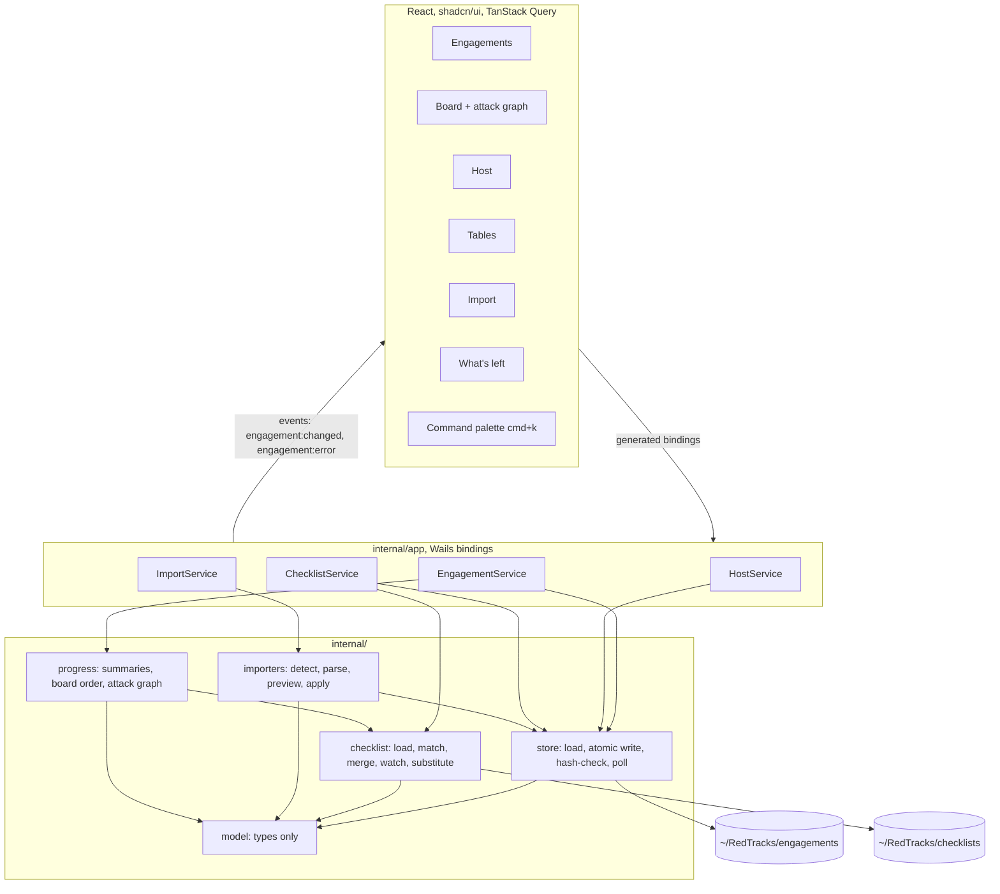
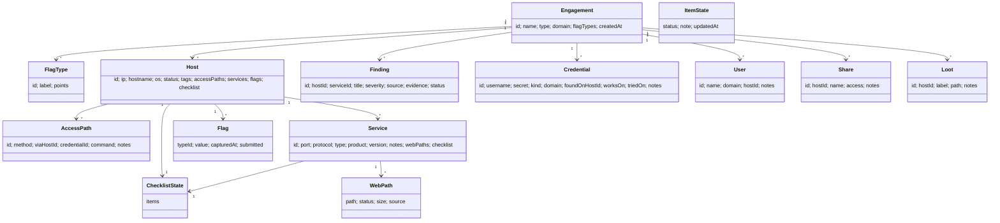
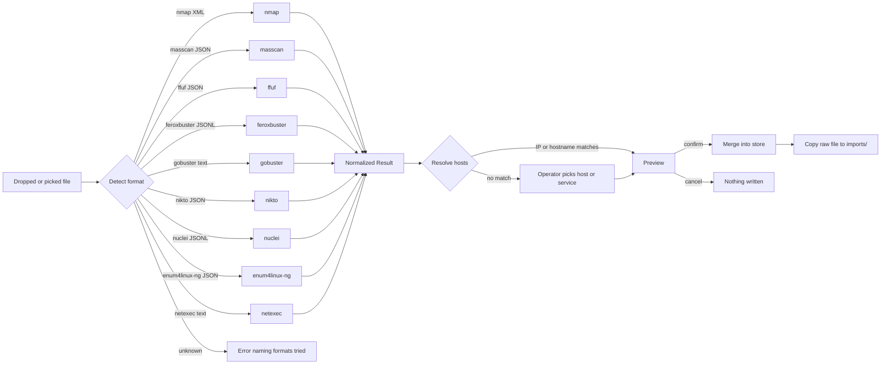

# Design Document: RedTracks Slice One

## Overview

RedTracks is an offline, single-user macOS desktop app for tracking the state of a penetration test — hosts, services, per-service checklists, credentials, users, shares, loot, findings, and flags — during OffSec labs and exams (OSCP+, OSAI) and CTFs. It replaces the templated-note workflow with structure as data: the app can tell the operator which ports still have untouched checklists, which credentials were never tried against a host, which flags are missing, and how each host is reached.

The app is a [Wails v3](https://v3.wails.io/) shell: a Go backend that holds every tested behavior, and an embedded React + TypeScript + shadcn/ui frontend that is only tables and forms. All state is plain JSON files (plus `notes.md`) under `~/RedTracks`, readable and hand-editable in vim if the app ever breaks. There is no database, no network call, no telemetry, and no multi-user support. The files are the interface, and the app keeps faith with external edits through a single atomic write path with per-file SHA-256 hash-check-and-reapply and a two-second mtime poll.

Slice one delivers six screens (Engagements, Board, Host, Tables, Import, What's left) plus a `cmd+k` command palette, nine importer parsers covering ten tools (rustscan emits nmap XML, so it reuses the nmap parser), a pure "what's left" computation, and an autogenerated Mermaid attack graph rendered in strict security mode. This document is grounded in and consistent with the approved spec (`docs/superpowers/specs/2026-10-12-redtracks-slice1-design.md`), the implementation plan with requirements R1–R24 (`docs/plans/2026-10-12-001-feat-redtracks-slice-one-plan.md`), and the detailed signature plan (`docs/superpowers/plans/2026-10-12-redtracks-slice1.md`). Where the plan mentioned pnpm, this design follows the workspace steering rule and uses **bun**.

## Architecture

Data flows one direction through four layers: **Frontend → Wails services (`internal/app`) → core packages (`internal/*`) → disk**, with services emitting events back to the frontend for cache invalidation. The Wails services are deliberately thin — they translate frontend calls into store mutations and return model types. All logic and all tested behavior lives in the core packages (`model`, `store`, `checklist`, `importers`, `progress`), never in the services.



### Layering rules

- `internal/model` is types only, depends on nothing.
- `internal/store` owns every byte written under `~/RedTracks` through one `WriteAtomic` function. The one exemption is the append-only log in `internal/app/log.go`, which appends and rotates by rename.
- `internal/checklist`, `internal/importers`, and `internal/progress` are pure apart from three named disk-touching functions: `checklist.LoadDefinitions`, `checklist.InstallDefaults`, and `importers.Apply`.
- `internal/app` services are thin and hold no business logic. Callers never hold pointers into store state; mutations are applied via closures against a freshly re-read document.

### Package responsibilities

| Package              | Responsibility                                                                           | Depends on       |
| -------------------- | ---------------------------------------------------------------------------------------- | ---------------- |
| `internal/model`     | Domain types, ID generation, default flag sets                                           | nothing          |
| `internal/store`     | Load engagement, atomic write, hash-check and reapply, mtime poll, parse error reporting | model            |
| `internal/checklist` | Load definitions, match to service or host, merge with state, safe substitution, watch   | model            |
| `internal/importers` | One parser per tool, detection, normalized result, preview and merge                     | model, store     |
| `internal/progress`  | What's left, board sort, Mermaid attack graph                                            | model, checklist |
| `internal/app`       | Four thin Wails services, rotating log, poller lifecycle, binding surface                | all of the above |
| `main.go`            | Wails application, service registration, window, server-mode fallback                    | internal/app     |

### Mutation path (sequence)

Host, engagement, table, and import writes take the hash-check-and-reapply path. Notes saves do **not**: `WriteNotes` compares the on-disk hash with the base hash the editor loaded and fails with a conflict when they differ, so an external edit is never silently reapplied over.

```mermaid
sequenceDiagram
  participant UI
  participant Svc as HostService
  participant St as store.Store
  participant FS as disk
  UI->>Svc: SetItem(ip, serviceID, itemID, status, note)
  Svc->>St: MutateHost(ip, fn)
  St->>St: lock; read host.json bytes
  alt SHA-256 differs from last read
    St->>FS: re-read and reparse fresh document
    St->>St: replace in-memory copy
  end
  St->>St: apply fn to a copy
  St->>FS: WriteAtomic(temp, fsync, rename)
  St->>St: store new hash and value
  St-->>Svc: nil
  Svc-->>UI: resolved promise
  Note over St,UI: poller sees mtime change, emits engagement:changed, frontend invalidates queries
```

### Import flow (sequence)

```mermaid
sequenceDiagram
  participant UI as Import screen
  participant IS as ImportService
  participant IMP as importers
  participant St as store.Store
  UI->>IS: PreviewData(name, base64)
  IS->>IMP: Parse(data) -> Detect then dispatch
  IMP-->>IS: Result{Tool, Hosts, Dropped}
  IS->>IMP: BuildPreview(eng, res, overrides)
  IMP-->>IS: Preview{Rows[new|fills|duplicate], Unresolved[]}
  IS-->>UI: PreviewResponse{Token, Preview}
  UI->>IS: Apply(token, overrides)
  IS->>IMP: Apply(store, res, overrides, raw)
  IMP->>St: MutateHost / AddHost / MutateCreds / MutateFindings
  IMP->>St: SaveImport(ip, tool, raw)
  IMP-->>IS: Preview (what was written)
  IS-->>UI: Preview with counts; navigate to Board
```

## Components and Interfaces

### EngagementService

**Purpose**: Engagement lifecycle, notes, and all engagement-wide tables (credentials, users, shares, loot, findings), plus the progress and attack-graph projections. Thin wrapper over `store` and `progress`.

**Interface (Go, exported methods become TypeScript bindings)**:

```go
type EngagementService struct{ app *App }

func (s *EngagementService) List() ([]store.Summary, error)
func (s *EngagementService) Create(name, domain string, t model.EngagementType) (string, error)
func (s *EngagementService) Open(dir string) (model.Engagement, error) // only a direct child of root/engagements
func (s *EngagementService) Current() (model.Engagement, error)
func (s *EngagementService) Summaries() ([]progress.HostSummary, error)
func (s *EngagementService) AttackGraph() (string, error)

type Notes struct{ Text, Hash string }
func (s *EngagementService) ReadNotes(ip string) (Notes, error)        // ip == "" => engagement notes.md
func (s *EngagementService) WriteNotes(ip, text, baseHash string) error // error message starts with "conflict" on ErrConflict

func (s *EngagementService) AddCredential(c model.Credential) error
func (s *EngagementService) UpdateCredential(c model.Credential) error // scalar fields only; WorksOn/TriedOn untouched
func (s *EngagementService) MarkTried(credID, hostIP string, works bool) error
func (s *EngagementService) DeleteCredential(id string) error
func (s *EngagementService) AddUser(u model.User) error
func (s *EngagementService) UpdateUser(u model.User) error
func (s *EngagementService) DeleteUser(id string) error
func (s *EngagementService) AddShare(sh model.Share) error
func (s *EngagementService) UpdateShare(sh model.Share) error
func (s *EngagementService) DeleteShare(id string) error
func (s *EngagementService) AddLoot(l model.Loot) error
func (s *EngagementService) UpdateLoot(l model.Loot) error
func (s *EngagementService) DeleteLoot(id string) error
func (s *EngagementService) AddFinding(f model.Finding) error
func (s *EngagementService) UpdateFinding(f model.Finding) error
func (s *EngagementService) DeleteFinding(id string) error
```

**Responsibilities**:

- `Open` rejects any dir that is not a direct child of `root/engagements`, cancels the previous poller under the app mutex, swaps the store, and starts a new `Poll` whose `onChange` emits `engagement:changed` and whose `onError` emits `engagement:error`.
- Update methods replace scalar fields only, so a stale form cannot revert concurrent changes to `WorksOn`, `TriedOn`, `WebPaths`, or checklist state.
- Every method logs errors at `Error` level with the method name before returning; secrets and flag values are never logged.

### HostService

**Purpose**: Host-scoped mutations — status, services, access paths, flags, checklist items — and checklist views for a service or host.

**Interface**:

```go
type HostService struct{ app *App }

func (s *HostService) Add(ip, hostname string) error
func (s *HostService) Update(h model.Host) error                          // scalar fields only; not services/flags/checklist
func (s *HostService) SetStatus(ip string, st model.HostStatus) error
func (s *HostService) AddService(ip string, svc model.Service) error
func (s *HostService) UpdateService(ip string, svc model.Service) error   // scalar fields only; WebPaths/Checklist untouched
func (s *HostService) AddAccessPath(ip string, p model.AccessPath) error
func (s *HostService) RemoveAccessPath(ip, pathID string) error
func (s *HostService) SetFlag(ip string, f model.Flag) error
func (s *HostService) SetItem(ip, serviceID, itemID string, st model.ItemStatus, note string) error // serviceID "" => host checklist

type ChecklistView struct {
    Definition checklist.Definition
    Items      []checklist.ItemView
}
func (s *HostService) Checklists(ip, serviceID string) ([]ChecklistView, error)
```

### ImportService

**Purpose**: Stateful preview/apply lifecycle for file imports. Holds pending previews keyed by a one-shot token.

**Interface**:

```go
type ImportService struct {
    app     *App
    pending map[string]pendingImport
}

type PreviewResponse struct {
    Token   string
    Preview importers.Preview
}

func (s *ImportService) PreviewFile(path string) (PreviewResponse, error)
func (s *ImportService) PreviewData(name, dataBase64 string) (PreviewResponse, error) // standard base64; rejects decoded size over 20 MB
func (s *ImportService) Apply(token string, overrides map[string]string) (importers.Preview, error)
func (s *ImportService) Discard(token string) error
```

**Responsibilities**: `Apply` errors with "unknown token" when the token was already used or discarded, so the UI cannot double-apply.

### ChecklistService

**Purpose**: Expose loaded definitions, force a reload, and perform safe command substitution.

**Interface**:

```go
type ChecklistService struct{ app *App }

func (s *ChecklistService) Definitions() ([]checklist.Definition, error)
func (s *ChecklistService) Reload() error
func (s *ChecklistService) Command(cmd, ip, domain string) (string, error) // delegates to checklist.Substitute
```

### App (shared backend state)

**Purpose**: Holds the mutex-guarded store, the current poller cancel func, the loaded definitions, the logger, and the event emitter. One per process.

**Interface**:

```go
type App struct {
    Root       string
    mu         sync.Mutex
    store      *store.Store
    cancelPoll context.CancelFunc
    defs       []checklist.Definition
    log        *slog.Logger
    emit       func(name string, data any)
}

func New(root string) (*App, error)                      // InstallDefaults, OpenLog, LoadDefinitions, start checklist.Watch; a bad definition is logged, never fatal
func (a *App) SetEmitter(fn func(name string, data any)) // main.go wires app.Event.Emit after application.New
func (a *App) Store() (*store.Store, error)              // error "no engagement open" when nil
func (a *App) Definitions() []checklist.Definition
```

`New` starts `checklist.Watch` over `root/checklists` at 2s: `onChange` swaps `a.defs` under the mutex and emits `engagement:changed` with `["checklists"]`; `onError` emits `engagement:error` naming the definition file and position. `emit` is a no-op until `SetEmitter` is called.

### Mermaid (frontend component)

**Purpose**: Render Mermaid text safely.

**Interface**:

```tsx
function Mermaid(props: { chart: string }): JSX.Element
```

**Responsibilities**: Initialize once per module with `mermaid.initialize({ startOnLoad: false, securityLevel: 'strict', theme: 'dark' })`, render with `mermaid.render`, sanitize the returned SVG with DOMPurify before insertion, and fall back to the raw text in a `<pre>` on render error. Strict security mode plus DOMPurify is the second line of defense behind the Go-side label escaping (the first).

### Query layer (frontend)

**Purpose**: Event-driven cache invalidation.

**Interface**:

```ts
export const queryClient: QueryClient
// query keys: ["engagements"], ["engagement"], ["summaries"], ["graph"],
//             ["checklists", ip, serviceId], ["notes", ip], ["definitions"]
```

**Responsibilities**: Subscribe to `engagement:changed` and invalidate `engagement`, `summaries`, `graph`, `checklists`, and `definitions` — but never `notes` (the notes editor owns its own refresh). Subscribe to `engagement:error` and store the latest message for the `AppShell` banner, cleared on the next `engagement:changed`. A `MutationCache.onError` raises a persistent sonner toast unless the mutation sets `meta.silent`; a `QueryCache.onError` only logs because failed queries render through `QueryStates`.

## Data Models

Types live in `internal/model` (types only, no logic beyond `NewID` and `DefaultFlagTypes`). JSON tags are camelCase, written with `json.MarshalIndent(v, "", "  ")`, and field order follows struct order to keep hand edits and diffs small. The TypeScript equivalents are generated into `frontend/bindings/` and must never be hand-edited.

```go
type EngagementType string // "lab" | "oscp" | "osai" | "custom"
type HostStatus string     // "untouched" | "enumerating" | "foothold" | "user" | "root" | "done"
type ItemStatus string     // "todo" | "done" | "skipped" | "na"

type FlagType struct {
    ID     string `json:"id"`
    Label  string `json:"label"`
    Points int    `json:"points"`
}

type EngagementMeta struct {
    ID        string         `json:"id"`
    Name      string         `json:"name"`
    Type      EngagementType `json:"type"`
    Domain    string         `json:"domain"` // optional, e.g. corp.local; source for $D
    FlagTypes []FlagType     `json:"flagTypes"`
    CreatedAt time.Time      `json:"createdAt"`
}

type AccessPath struct {
    ID           string `json:"id"`
    Method       string `json:"method"`       // direct | chisel | ssh-tunnel | rdp | winrm | other
    ViaHostID    string `json:"viaHostId"`
    CredentialID string `json:"credentialId"`
    Command      string `json:"command"`
    Notes        string `json:"notes"`
}

type WebPath struct {
    Path   string `json:"path"`
    Status int    `json:"status"`
    Size   int    `json:"size"`
    Source string `json:"source"`
}

type ItemState struct {
    Status    ItemStatus `json:"status"`
    Note      string     `json:"note"`
    UpdatedAt string     `json:"updatedAt"`
}

type ChecklistState struct {
    Items map[string]ItemState `json:"items"`
}

type Service struct {
    ID        string         `json:"id"`
    Port      int            `json:"port"`
    Protocol  string         `json:"protocol"` // tcp | udp
    Type      string         `json:"type"`     // open string; nmap name or operator-set AI type
    Product   string         `json:"product"`
    Version   string         `json:"version"`
    Notes     string         `json:"notes"`
    WebPaths  []WebPath      `json:"webPaths"`
    Checklist ChecklistState `json:"checklist"`
}

type Flag struct {
    TypeID    string `json:"typeId"`
    Value     string `json:"value"`
    CapturedAt string `json:"capturedAt"`
    Submitted bool   `json:"submitted"`
}

type Host struct {
    ID          string         `json:"id"`
    IP          string         `json:"ip"`
    Hostname    string         `json:"hostname"`
    OS          string         `json:"os"`
    Status      HostStatus     `json:"status"`
    Tags        []string       `json:"tags"`
    AccessPaths []AccessPath   `json:"accessPaths"` // ordered before services, flags
    Services    []Service      `json:"services"`
    Flags       []Flag         `json:"flags"`
    Checklist   ChecklistState `json:"checklist"`
}

type Finding struct {
    ID       string `json:"id"`
    HostID   string `json:"hostId"`
    ServiceID string `json:"serviceId"`
    Title    string `json:"title"`
    Severity string `json:"severity"` // info | low | medium | high | critical
    Source   string `json:"source"`
    Evidence string `json:"evidence"`
    Status   string `json:"status"` // noted | confirmed | exploited | false-positive
}

type Credential struct {
    ID            string   `json:"id"`
    Username      string   `json:"username"`
    Secret        string   `json:"secret"`
    Kind          string   `json:"kind"` // password | hash | key | token
    Domain        string   `json:"domain"`
    FoundOnHostID string   `json:"foundOnHostId"`
    WorksOn       []string `json:"worksOn"`
    TriedOn       []string `json:"triedOn"`
    Notes         string   `json:"notes"`
}

type User struct {
    ID     string `json:"id"`
    Name   string `json:"name"`
    Domain string `json:"domain"`
    HostID string `json:"hostId"`
    Notes  string `json:"notes"`
}

type Share struct {
    ID     string `json:"id"`
    HostID string `json:"hostId"`
    Name   string `json:"name"`
    Access string `json:"access"`
    Notes  string `json:"notes"`
}

type Loot struct {
    ID     string `json:"id"`
    HostID string `json:"hostId"`
    Label  string `json:"label"`
    Path   string `json:"path"`
    Notes  string `json:"notes"`
}

type Creds struct {
    Credentials []Credential `json:"credentials"`
    Users       []User       `json:"users"`
    Shares      []Share      `json:"shares"`
    Loot        []Loot       `json:"loot"`
}

type FindingsFile struct {
    Findings []Finding `json:"findings"`
}

type Engagement struct {
    Dir      string         // in-memory only, not persisted
    Meta     EngagementMeta
    Hosts    []Host
    Creds    Creds
    Findings []Finding
}

func NewID() string                               // crypto/rand.Text(); opaque, never shown as primary label
func DefaultFlagTypes(t EngagementType) []FlagType
func (h Host) Service(id string) (Service, bool)
func (e Engagement) Host(ip string) (Host, bool)
```

### Domain relationships



### Validation rules

- **Default flag types** by engagement type: `lab` and `oscp` give `local` (10) and `proof` (10); `osai` gives `ai_vector` (15), `trad_vector` (10), `proof` (5); `custom` gives an empty slice. The operator edits them in `engagement.json`.
- **Service type** is an open string. Importers never guess an AI type (`llm-chat`, `mcp-server`, `agent`, `rag-api`, `vector-store`, `model-registry`, `inference-api`); the operator sets those.
- **Hashes** are credentials with `kind: hash`; there is no separate hash table.
- **Record IDs** come from `model.NewID()` (`crypto/rand.Text`), are opaque, and are never shown as the primary label.
- **Host folder names** come only from IPs that pass `netip.ParseAddr`. The three `ip`-taking layout helpers reject invalid IPs; only engagement-level `notesPath` accepts the empty string.
- **A `host.json` whose `ip` disagrees with its folder name** is a parse error naming both values and the path; the store refuses to write it.

## Files on Disk

```
~/RedTracks/
  checklists/                 human-owned; copied once on first launch, never overwritten
    http.json  smb.json  ldap.json  kerberos.json  ssh.json
    mcp-server.json  llm-chat.json  rag-api.json
    linux-privesc.json  windows-privesc.json
    _readme.md
  engagements/
    pg-nibbles/
      engagement.json         app-owned
      notes.md                human-owned, edited in place, never restructured
      creds.json              app-owned: credentials, users, shares, loot
      findings.json           app-owned
      hosts/
        10.10.10.5/
          host.json           app-owned: host, access paths, services, flags, checklist state
          notes.md            human-owned
          imports/
            nmap-20261012-140312.xml   raw tool output, copied unchanged
  redtracks.log               app-owned, plain text, rotated at 5 MB to .1
```

### Ownership

- **Human-owned**: `notes.md` files and everything under `checklists/`. The app reads and displays, edits `notes.md` in place, but never restructures them.
- **App-owned**: `engagement.json`, `creds.json`, `findings.json`, `host.json` — written with two-space indentation and struct-ordered fields.
- **Imports**: raw tool output copied unchanged into `hosts/<ip>/imports/` with a tool prefix and timestamp. A subnet scan touching several hosts is stored under the first resolved host and referenced by path from the others.

### Faith-keeping rules (R1–R7)

1. The app loads an engagement folder into memory on open. No cache, no index.
2. Every write is atomic: temp file in the same directory, fsync, rename over the original. One function (`store.WriteAtomic`) performs all writes; there is no second write path (the log is the one documented exemption).
3. The store keeps a SHA-256 of the bytes it last read for every file. Before a write it re-reads; if the hash differs, it reparses the fresh document, applies the pending mutation closure (keyed by record ID) to it, and writes that. Both the external edit and the app's edit land.
4. A poller checks mtimes every two seconds and reloads changed files. Ten hosts is roughly fifteen files; polling is cheaper than a watcher dependency. Marked as a known ceiling (`ponytail: swap for fsnotify if an engagement ever has hundreds of hosts`).
5. A file that fails to parse is reported with path, line, and column. The app refuses to overwrite it and never rewrites a file to "fix" it.
6. Missing files are not errors on read. A host folder with only `notes.md` is a host with no structured state yet.
7. `notes.md` saves use a conflict baseline: `ReadNotes` returns text plus hash; `WriteNotes` takes the base hash the editor loaded and returns `ErrConflict` when the on-disk hash differs. No silent clobber.

## Store Package

**Purpose**: Own every byte written under an engagement folder, with hash-checked mutations and positioned parse errors.

**Interface**:

```go
// atomic.go
func WriteAtomic(path string, data []byte) error // temp in same dir, fsync, rename, mode 0644

// parse.go
type ParseError struct {
    Path string
    Line, Col int
    Err  error
}
func (e *ParseError) Error() string                      // "<path>:<line>:<col>: <err>"
func decodeJSON(path string, data []byte, v any) error   // maps *json.SyntaxError and *json.UnmarshalTypeError to ParseError via byte offset

// store.go
var ErrConflict = errors.New("conflict") // callers wrap with %w; frontend matches the "conflict" prefix

type Store struct {
    // dir, engagement, hashes map[string][32]byte, mu sync.Mutex
}

func Open(dir string) (*Store, error)                   // loads everything; missing files are not errors
func (s *Store) Engagement() model.Engagement           // deep-copy snapshot; callers never hold store pointers
func (s *Store) Reload() (changed []string, err error)  // re-reads changed mtimes; keeps last good copy on parse error, returns *ParseError after processing the rest
func (s *Store) MutateMeta(fn func(*model.EngagementMeta) error) error
func (s *Store) MutateHost(ip string, fn func(*model.Host) error) error
func (s *Store) AddHost(h model.Host) error             // creates hosts/<ip>/ and host.json; error if exists
func (s *Store) MutateCreds(fn func(*model.Creds) error) error
func (s *Store) MutateFindings(fn func(*model.FindingsFile) error) error
func (s *Store) ReadNotes(ip string) (text, hash string, err error) // ip "" => engagement notes.md; hash is hex SHA-256
func (s *Store) WriteNotes(ip, text, baseHash string) error         // ErrConflict when on-disk hash differs from baseHash
func (s *Store) SaveImport(ip, tool string, raw []byte) (relPath string, err error) // hosts/<ip>/imports/<tool>-<yyyymmdd-hhmmss>.<ext>

// layout.go
// metaPath, credsPath, findingsPath, hostDir, hostPath, notesPath
// the three ip-taking helpers reject ip failing netip.ParseAddr; only notesPath accepts ""

// root.go
func RootDir() string // $REDTRACKS_HOME or ~/RedTracks
type Summary struct {
    Dir, Name string
    Type      model.EngagementType
    Hosts     int
    CreatedAt time.Time
}
func ListEngagements(root string) ([]Summary, error)       // scans root/engagements; sorted CreatedAt desc
func CreateEngagement(root, name, domain string, t model.EngagementType) (dir string, err error)

// poll.go
func (s *Store) Poll(ctx context.Context, every time.Duration, onChange func(changed []string), onError func(err error))
```

### Mutation algorithm (every `Mutate*`)

```pascal
PROCEDURE Mutate(target, fn)
BEGIN
  LOCK s.mu
  bytes <- read file for target
  IF sha256(bytes) <> s.hashes[target] THEN
    fresh <- decodeJSON(path, bytes)     // reparse the externally changed document
    IF error THEN RETURN *ParseError END IF
    replace in-memory copy with fresh
  END IF
  copy <- deep copy of in-memory value
  err <- fn(&copy)                        // apply the mutation closure
  IF err THEN RETURN err END IF
  out <- MarshalIndent(copy, "", "  ")
  WriteAtomic(path, out)
  s.hashes[target] <- sha256(out)
  replace in-memory value with copy
  UNLOCK s.mu
END
```

**Preconditions**: `fn` is pure over its argument and keyed by record ID; `target` resolves to a validated path. **Postconditions**: both an external edit and `fn`'s edit are present on disk; the caller holds no pointer into store state; the stored hash matches the written bytes.

`CreateEngagement` rejects a raw `name` containing `/`, `\`, or `..`, slugifies to `[a-z0-9-]+`, rejects an empty slug, then creates `engagement.json` (with `Domain` and the type's flag types), an empty `notes.md`, and `hosts/`. `SaveImport` picks the extension from the raw bytes: `xml` if they start with `<`, `json` if `{` or `[`, else `txt`.

## Checklist Package

**Purpose**: Load JSON definitions, match them to services and hosts, merge with recorded state, substitute commands safely, hot-reload, and install the shipped set once.

**Interface**:

```go
type Item struct {
    ID, Title, Hint string
    Commands        []string
}
type Match struct {
    ServiceTypes []string
    HostOS       []string
}
type Definition struct {
    ID, Title string
    Match     Match
    Items     []Item
    File      string
}
type ItemView struct {
    Item
    State model.ItemState
}

func LoadDefinitions(dir string) ([]Definition, error)               // error names both files on duplicate item IDs
func ForService(defs []Definition, s model.Service) []Definition
func ForHost(defs []Definition, h model.Host) []Definition
func Merge(def Definition, state model.ChecklistState) []ItemView     // missing state means todo
func Substitute(cmd, targetIP, domain string) (string, error)        // $T and $D only
func Watch(ctx context.Context, dir string, every time.Duration, onChange func([]Definition), onError func(error))
func InstallDefaults(src fs.FS, dst string) (installed bool, err error) // no-op if dst exists
```

The shipped set is embedded via `//go:embed *.json _readme.md` in `checklists/embed.go` and copied into `~/RedTracks/checklists/` only when that directory does not already exist.

### Definition format

```json
{
  "id": "http",
  "title": "HTTP / HTTPS",
  "match": {
    "serviceTypes": [
      "http",
      "https",
      "http-proxy",
      "http-alt"
    ]
  },
  "items": [
    {
      "id": "http.robots",
      "title": "robots.txt, sitemap.xml, .well-known",
      "hint": "",
      "commands": [
        "curl -s http://$T/robots.txt"
      ]
    }
  ]
}
```

- `match.serviceTypes` matches a service by type; `match.hostOS` matches a host by OS (privesc lists). A definition may use either or both.
- Item IDs are stable strings chosen by the author; state is keyed by item ID. Renaming a title keeps history; changing an ID starts fresh.
- `$T` (target IP) and `$D` (domain) are the only placeholders, substituted when a command is copied to the clipboard.
- Match rules for the shipped set: `http` matches `http`/`https`/`http-proxy`/`http-alt`; `smb` matches `microsoft-ds`/`netbios-ssn`/`smb`; `ldap` matches `ldap`/`ldaps`; `kerberos` matches `kerberos-sec`/`kerberos`; `ssh` matches `ssh`; the three AI definitions match their own type name; `linux-privesc` has `hostOS: ["linux"]`; `windows-privesc` has `hostOS: ["windows"]`.

### Safe substitution

```pascal
FUNCTION Substitute(cmd, targetIP, domain) -> (string, error)
BEGIN
  IF NOT netip.ParseAddr(targetIP) succeeds THEN
    RETURN "", error("invalid target IP")
  END IF
  IF domain <> "" AND NOT domain matches ^[A-Za-z0-9._-]+$ THEN
    RETURN "", error("invalid domain")   // rejects ; | newline and other shell metacharacters
  END IF
  out <- replace "$T" with targetIP in cmd
  out <- replace "$D" with domain in out
  RETURN out, nil
END
```

**Preconditions**: `cmd` may contain `$T` and `$D`. **Postconditions**: the result contains no attacker-controlled shell metacharacters introduced through `$T` or `$D`; a hostile IP or domain yields an error, never a substituted command. This is the first line of defense for target-controlled strings becoming shell substitutions.

## Importers Package

**Purpose**: Detect a dropped file's tool from its content, parse it into a normalized `Result`, build a preview, and merge into the store.



**Interface**:

```go
type ServiceResult struct{ Port int; Protocol, Type, Product, Version string }
type WebPathResult struct{ Path string; Status, Size int }
type FindingResult struct{ Title, Severity, Evidence string; Port int }
type UserResult struct{ Name, Domain string }
type ShareResult struct{ Name, Access string }
type HostResult struct {
    IP, Hostname, OS, URL string
    Services []ServiceResult
    WebPaths []WebPathResult
    Findings []FindingResult
    Users    []UserResult
    Shares   []ShareResult
}
type Result struct {
    Tool    string
    Hosts   []HostResult
    Dropped int // HostResults removed because a non-empty IP failed netip.ParseAddr
}

var ErrUnknownFormat = errors.New("unknown format")
func Detect(head []byte) (tool string, err error) // err wraps ErrUnknownFormat and lists tools tried
func Parse(data []byte) (Result, error)           // Detect then dispatch via parsers map
var parsers = map[string]func([]byte) (Result, error) // keyed by exact tool name

// Each parser is one file: func parseX(data []byte) (Result, error)
// Tool names: nmap, masscan, ffuf, feroxbuster, gobuster, nikto, nuclei, enum4linux-ng, netexec

// merge.go
type Badge string // "new" | "fills" | "duplicate"
type Row struct {
    Kind   string // host | service | webpath | finding | user | share
    HostIP string
    Badge  Badge
    Label  string
}
type Unresolved struct {
    Key      string // what Apply's overrides map uses
    Hostname string
    URL      string
}
type Preview struct {
    Tool       string
    Rows       []Row
    Unresolved []Unresolved
}
func BuildPreview(eng model.Engagement, res Result, overrides map[string]string) Preview
func Apply(st *store.Store, res Result, overrides map[string]string, raw []byte) (Preview, error)
```

### Tools in slice one

| Group     | Tool          | Input                | Produces                                                      |
| --------- | ------------- | -------------------- | ------------------------------------------------------------- |
| Port scan | nmap          | XML                  | hosts, hostnames, OS guess, services with product and version |
| Port scan | rustscan      | XML (wraps nmap)     | same as nmap, no separate parser                              |
| Port scan | masscan       | JSON                 | hosts, open ports with empty type                             |
| Vuln scan | nikto         | JSON                 | findings on an http service, severity info                    |
| Vuln scan | nuclei        | JSONL                | findings on a service, severity from template, lowercased     |
| Web enum  | ffuf          | JSON                 | web paths on a service                                        |
| Web enum  | feroxbuster   | JSONL                | web paths on a service                                        |
| Web enum  | gobuster      | text (dir mode)      | web paths; no IP or URL, resolves via operator picker         |
| SMB / AD  | enum4linux-ng | JSON                 | users, shares, domain, OS                                     |
| SMB / AD  | netexec       | text (ANSI stripped) | users, shares, OS, signing, credential validity               |

### Detection

Detection sniffs the first few kilobytes: `<nmaprun` for nmap; a JSON array whose objects carry `ports` for masscan; `"commandline"` plus `"results"` for ffuf; lines with `"type":"response"` for feroxbuster; lines matching `^/\S+\s+\(Status: \d+\)` for gobuster; `"vulnerabilities"` with `"host"` for nikto; `"template-id"` for nuclei; top-level `"target"` and `"users"` or `"shares"` for enum4linux-ng; lines starting with `SMB` or `LDAP` then an IP and port for netexec. Adding a tool is one parser file, one sniff rule, one fixture. Only open ports become services; `state="down"` hosts are skipped; a `HostResult` whose non-empty IP fails `netip.ParseAddr` is dropped and counted in `Dropped`. The netexec parser strips ANSI escape sequences (`\x1b[...m`) before matching, and enum4linux-ng/netexec drop a domain containing whitespace or control characters.

### Resolution and merge (R17, R18)

```pascal
ALGORITHM Resolve(hostResult, eng, overrides)
BEGIN
  IF hostResult.IP <> "" THEN RETURN resolved(hostResult.IP) END IF
  IF hostResult.URL <> "" THEN
    urlHost <- host part of hostResult.URL
    IF urlHost = some eng host's IP or Hostname THEN RETURN resolved(that IP) END IF
    IF overrides[urlHost] set THEN RETURN resolved(override, port from override or URL or 80) END IF
    RETURN Unresolved{Key: urlHost, URL: hostResult.URL}
  END IF
  // neither IP nor URL (gobuster)
  IF overrides[tool] set THEN RETURN resolved(override ip[:port]) END IF
  RETURN Unresolved{Key: tool}
END
```

Merge rules:

- A host is matched by IP; if none exists it is created with status `untouched`.
- A service is matched by port and protocol. An existing service keeps its type, product, version, and notes unless those fields are empty, in which case the import fills them. An import never overwrites an operator-set type.
- Web paths and findings attach to the service whose port equals the URL port (default 80 for http, 443 for https); if none exists it is created with `Type` from the scheme.
- Web paths are deduplicated by path and status; findings by source and title per service; users and shares by name per host.
- Unresolved hosts are never written; `Apply` reports them in `Preview.Unresolved` so the UI can count what was skipped. The preview shows every row with a `new`, `fills`, or `duplicate` badge; nothing is written until the operator confirms.
- `Apply` writes everything else through `MutateHost`, `AddHost`, `MutateCreds`, `MutateFindings`, and saves the raw file under the first resolved host. Merge is idempotent, so a mid-import failure is completed by a retry.

## Progress Package

**Purpose**: Pure functions over the loaded engagement — the "what's left" summaries, board ordering, and the Mermaid attack graph. No I/O.

**Interface**:

```go
type HostSummary struct {
    HostID, IP, Hostname string
    Status               model.HostStatus
    MissingFlags         []string // flag type IDs with no value on this host
    UntouchedServices    []string // "80/tcp http"
    OpenItems            int      // todo items across host and service checklists
    UntriedCreds         []string // credential IDs
    NoAccessPath         bool
    FlagPoints, TotalPoints int
    ItemsDone, ItemsTotal   int
}
func Summarize(eng model.Engagement, defs []checklist.Definition) []HostSummary // board order
func AttackGraph(eng model.Engagement) string                                   // Mermaid flowchart LR
```

### What's left, per host (R19)

- **Missing flags**: flag types in the engagement with no value on this host.
- **Untouched services**: services with a matching checklist definition where every item is `todo`. A service type with no definition is never listed.
- **Open items**: count of `todo` items across host and service checklists.
- **Untried credentials**: credentials whose `triedOn` and `worksOn` do not include this host, excluding credentials found on this host.
- **No access path**: true when the host has no access path and status is beyond `untouched`.

**Board sort**: ascending by captured flag points over total points, then by checklist completion ratio. The most neglected host is on top.

### Attack graph (R20)

```pascal
ALGORITHM AttackGraph(eng) -> string
BEGIN
  emit "flowchart LR"
  emit a classDef line per host status (fill colour; frontend does not restyle)
  emit node "attacker" labelled with the attacker box
  FOR each host h IN eng.Hosts DO
    nodeID <- "h_" + h.IP with dots replaced by underscores
    label  <- escape(h.IP + " " + h.Hostname)
    emit node nodeID labelled label, class = h.Status
  END FOR
  FOR each host h, each access path p DO
    from <- node(p.ViaHostID) if set, else "attacker"
    emit edge from --> node(h) labelled escape(p.Method)
  END FOR
  // hosts with no access path stay unconnected, which is itself the signal
END

FUNCTION escape(s) -> string
BEGIN
  s <- replace '"' with "#quot;"
  s <- strip '<', '>', and newlines
  s <- cut to 60 characters
  RETURN quoted s
END
```

**Preconditions**: `eng` is a loaded engagement; hostnames and methods may be attacker-controlled. **Postconditions**: output starts with `flowchart LR`; no `"]` appears outside a quoted label and no raw `<` appears, so a hostile hostname or method cannot break out of a Mermaid label. The frontend renders this with mermaid.js in strict security mode plus DOMPurify — the escaping here is the first line of defense, strict mode the second.

## Correctness Properties

These are the invariants the property-based tests will quantify over. Each is stated against the Go signatures above and grounded in the faith-keeping rules (R1–R7), the merge rules, and the escaping/validation behavior already specified. Generators are noted where the quantification matters.

**Store (`internal/store`)**

### Property 1: Round-trip equality

**Validates: Requirements 1.1, 2.1**

For any valid `model.Engagement` `e` (generator: arbitrary hosts, services, creds, users, shares, loot, findings with valid IPs and struct-shaped fields), opening a store on a fresh dir, applying `MutateMeta`/`MutateHost`/`AddHost`/`MutateCreds`/`MutateFindings` to write `e`, then `Open`ing a new store on the same dir yields an engagement equal to `e` modulo in-memory-only fields. Equality ignores `Engagement.Dir` (not persisted) and compares all persisted fields. The on-disk JSON is indented with exactly two spaces (`MarshalIndent(v, "", "  ")`) and field order follows struct order.

- Invariant: `∀ e . normalize(Open(write(e)).Engagement()) == normalize(e)`, where `normalize` zeroes `Dir`.
- Invariant: every app-owned `*.json` byte stream re-marshals to itself (`bytes == MarshalIndent(decode(bytes), "", "  ")`).

### Property 2: Atomic write durability

**Validates: Requirements 2.1, 2.2**

For any existing file contents `b0` and any write that fails or is interrupted before the final rename (generator: inject a failure at temp-create, write, fsync, or pre-rename), the original file still holds exactly `b0` afterward, and no temp file is left behind on a successful write.

- Invariant: `WriteAtomic` either replaces the file with the new bytes in full or leaves `b0` untouched; there is no observable partial-write state.
- Invariant: after any successful `WriteAtomic(path, data)`, the directory of `path` contains no leftover temp file, and the stored hash equals `sha256(data)`.

### Property 3: Hash-check-and-reapply

**Validates: Requirements 3.1**

For any valid engagement, any external edit to field A of an app-owned file and a concurrent in-app `Mutate*` closure that touches a disjoint field B (generator: pick two record-ID-keyed fields A ≠ B), after the mutation completes both edits are present on disk.

- Invariant: `∀ (editA, mutateB) with fields(editA) ∩ fields(mutateB) = ∅ . after mutateB, read().A == editA.A ∧ read().B == mutateB.B`.
- Invariant: the stored hash after the mutation equals `sha256` of the written bytes (the reparse-and-reapply path leaves the hash consistent).

### Property 4: Notes conflict detection

**Validates: Requirements 5.1**

For any notes file with current hash `h` and any `(text, baseHash)` pair:

- Invariant: `baseHash ≠ h ⟹ WriteNotes` returns `ErrConflict` (message prefix `conflict`) and the file bytes are unchanged.
- Invariant: `baseHash == h ⟹ WriteNotes` succeeds and the file content becomes `text`.
- Generator: arbitrary prior content, arbitrary new `text`, and a `baseHash` drawn as either the current hash or any other hex string.

### Property 5: Host folder / path validation

**Validates: Requirements 7.1, 4.1**

For any `ip` string that fails `netip.ParseAddr` (generator: traversal segments like `../`, path separators, empty, hostnames, malformed addresses), the three `ip`-taking layout helpers (`hostDir`, `hostPath`, `notesPath` with non-empty `ip`) reject it, and `AddHost`/`SaveImport` reject it and write nothing. Only engagement-level `notesPath("")` accepts the empty string.

- Invariant: `¬netip.ParseAddr(ip).ok ⟹ AddHost(host{IP: ip})` errors and creates no `hosts/<ip>/` directory or file; `SaveImport(ip, …)` errors and writes no import file.
- Invariant: a `host.json` whose `ip` disagrees with its folder name is a parse error naming both values and the path, and the store refuses to write it.

**Importers (`internal/importers`)**

### Property 6: Merge idempotence

**Validates: Requirements 18.1**

For any parsed `Result` `r` and any starting engagement, applying `r` twice via `Apply` produces the same engagement state as applying it once (generator: results with repeated web paths, duplicate findings, duplicate users/shares, and services on existing ports).

- Invariant: `Apply(Apply(s, r)) ≡ Apply(s, r)` for the engagement state (web paths deduped by path+status; findings deduped by source+title per service; users and shares deduped by name per host).
- Invariant: an operator-set service `Type` is never overwritten by a subsequent apply; fills only populate empty `type`/`product`/`version`/`notes`.

### Property 7: Host resolution

**Validates: Requirements 17.1**

For any `HostResult` whose IP is empty, whose URL host matches no engagement host IP or hostname, and for which no `overrides` entry (keyed by URL host or tool) is supplied, `Apply` reports it in `Preview.Unresolved` and writes nothing for it.

- Invariant: `unresolved(hr) ⟹ hr ∉ written ∧ hr.key ∈ Preview.Unresolved`.
- Invariant: a `HostResult` whose non-empty IP fails `netip.ParseAddr` is dropped, counted in `Result.Dropped`, and never written.

**Checklist (`internal/checklist`)**

### Property 8: State merge preserves history by ID

**Validates: Requirements 12.1**

For any `Definition` and any `model.ChecklistState` (generator: states with arbitrary subsets of item IDs, including stale IDs no longer in the definition), `Merge` never drops recorded state for an item whose ID still exists, and an item with no recorded state reads as `todo`.

- Invariant: `∀ item ∈ def.Items . state.Items[item.ID] present ⟹ view.State == state.Items[item.ID]; absent ⟹ view.State.Status == "todo"`.
- Invariant: renaming an item's `Title` while keeping its `ID` preserves its `ItemState`; changing an item's `ID` starts fresh (`todo`).

### Property 9: Safe substitution

**Validates: Requirements 15.1**

For any `cmd`, `targetIP`, and `domain` (generator: IPs and domains containing shell metacharacters such as `;`, `|`, `` ` ``, `$`, `&`, newlines, and otherwise-malformed values), `Substitute` only ever replaces the literal tokens `$T` and `$D`, and rejects any `targetIP` failing `netip.ParseAddr` or any non-empty `domain` not matching `^[A-Za-z0-9._-]+$`.

- Invariant: `Substitute` returns an error (and no substituted command) whenever `targetIP` or `domain` fails validation; no shell metacharacter from `targetIP`/`domain` can appear in a successful result.
- Invariant: on success, the output differs from `cmd` only at `$T`/`$D` occurrences, replaced by the validated `targetIP`/`domain`.

**Progress (`internal/progress`)**

### Property 10: Mermaid label safety

**Validates: Requirements 20.1**

For any engagement containing hostile `Hostname`, access-path `Method`, or `OS` strings (generator: strings with `"`, `<`, `>`, newlines, and `"]`), the `AttackGraph` output contains no unescaped quote, angle bracket, or newline inside a label that could break out of a node label, and every label is cut to at most 60 characters.

- Invariant: output begins with `flowchart LR`; `"` is rendered as `#quot;`; `<`, `>`, and newlines are stripped before quoting; no `"]` sequence appears outside a quoted label.
- Invariant: `∀ label . len(label_text) ≤ 60`.

**Model (`internal/model`)**

### Property 11: Default flag types

**Validates: Requirements 8.1**

`DefaultFlagTypes` returns exactly the specified labels and points per engagement type: `lab` and `oscp` → `local` (10) and `proof` (10); `osai` → `ai_vector` (15), `trad_vector` (10), `proof` (5); `custom` → empty slice.

- Invariant: `DefaultFlagTypes(t)` equals the fixed slice for each `t`, in the stated order, with the stated labels and points.

### Property 12: ID uniqueness

**Validates: Requirements 2.1**

`NewID` produces opaque, non-empty IDs that are collision-free across large samples (generator: draw N IDs for large N, e.g. 10⁴–10⁶).

- Invariant: `∀ i,j, i ≠ j . NewID()_i ≠ NewID()_j`; every ID is non-empty and is never used as a human-facing primary label.

## Frontend Screens

Feature-first folders under `src/features/`; shared UI in `src/components`; dark theme only. Every screen defines loading, empty, and error states through the shared `QueryStates` component, and colour is never the only signal (toggles use `aria-pressed`, icon-only buttons carry `aria-label`, state carried by colour also carries text or an icon, text meets 4.5:1 contrast).

1. **Engagements** — List engagements under `~/RedTracks/engagements`, open one, create one with a type picker (and optional domain) that sets flag types. The last-opened engagement is not remembered; reopening is one click.
2. **Board** — Attack graph card above a table with one row per host: IP and hostname, status badge, a chip per flag type (check icon plus label when captured, outlined otherwise), `ItemsDone/ItemsTotal` progress, access path count or a warning icon with "no access path". Sorted by neglect. Add host and Import actions; empty state offers both.
3. **Host** — Pinned header with status `Select` and flag chips; access paths list with add/remove; a two-pane body with the service list on the left and the selected service's checklist, web paths, and findings on the right; host-level (privesc) checklists in a tab beside Services; a collapsible notes editor at the bottom with a Markdown + Mermaid preview toggle. Checklist rows expand to hint, commands with copy buttons (copy passes the derived `$D`), and a note textarea; space toggles the focused row between `todo` and `done` and is ignored inside inputs. The notes editor owns its base hash and dirty flag, re-reads on each `engagement:changed`, and never adopts a refetch while dirty; a `conflict` error offers Reload or Overwrite.
4. **Tables** — One tab each for credentials, users, shares, loot, findings. Every row opens an edit dialog and has a delete-with-confirm. Credential rows show `worksOn` chips labelled "works" and `triedOn` chips labelled "tried" plus a one-click "tried on host X" action; secrets are masked with a per-row reveal that re-masks after ten seconds and a copy button.
5. **Import** — Drop zone or file picker (base64 with a 20 MB cap). The detected tool, parsed rows with `new`/`fills`/`duplicate` badges, a host-resolution picker (with a port input when there is no URL) for unresolved entries, a skip-unresolved option, confirm, and cancel (which discards the pending token). Unknown-format errors render inline and keep the zone ready.
6. **What's left** — One card per host in board order with the five signals, each item a link into the Host screen. Hosts with nothing left show one line and sort last.

**Command palette** (`cmd+k`): jump to a host or service by IP, hostname, or port; a "Go to <screen>" entry per route; and Add host. That plus space-to-toggle is the whole keyboard story for slice one.

## Error Handling

- **Parse failures** surface in the UI with `path:line:col: reason`; the file is left untouched and is never rewritten to "fix" it.
- **Unknown import formats** say so inline and list the formats tried.
- **Write failures** surface as a persistent sonner toast and are written to `~/RedTracks/redtracks.log` with the path and the Go error.
- **`engagement:error` events** (store parse errors from the poller, and checklist-definition load errors from the watcher) render as a persistent `Alert` banner in `AppShell` naming the file and line, cleared on the next `engagement:changed`.
- **Notes conflicts** return an error whose message starts with `conflict`; the editor offers Reload or Overwrite rather than clobbering.
- The log is plain text, appended, rotated at 5 MB by renaming to `.1`, using `log/slog` with no additional framework. Nothing is swallowed: a function that can fail returns an error, and every error reaches the UI, the log, or both. Credential secrets and flag values are never logged.

## Testing Strategy

Logic lives in Go, so that is where the tests are. Target is 80% line coverage in `internal/`; coverage is not measured for `main.go` or the frontend. Store and importer tests must pass under `-race`.

### Unit testing approach

| Package             | Tests                                                                                                                                                                                                                                                                                                                                                                                                                           |
| ------------------- | ------------------------------------------------------------------------------------------------------------------------------------------------------------------------------------------------------------------------------------------------------------------------------------------------------------------------------------------------------------------------------------------------------------------------------- |
| `model`             | Default flag types per engagement type with exact points; 1000 IDs distinct and non-empty; `Host` JSON field order (id first, accessPaths before services before flags).                                                                                                                                                                                                                                                        |
| `store`             | Load a fixture engagement, mutate, write, reload, compare. External edit then app write — both present. Corrupt JSON — error carries line and column, bytes unchanged. Atomic write — a mid-write failure leaves the original intact. IP-vs-folder mismatch error. Notes conflict with a second read in between. Traversal IPs rejected by `AddHost` and `SaveImport`. Poller delivers a changed path and reports parse errors. |
| `checklist`         | Match by service type, host OS, and both. State merge when a definition gained, lost, or renamed an item. Duplicate item ID across files names both. Substitute happy path and shell-metacharacter rejection. Watch reloads and keeps the last good set on error. Install once, never overwrite. Shipped set is exactly ten definitions with five to ten items each.                                                            |
| `importers`         | One real fixture per tool with a table test over the normalized result. Detection over all fixtures plus a garbage file. Down hosts and traversal addresses skipped (`Dropped == 1`). netexec with ANSI colour parses identically.                                                                                                                                                                                              |
| `importers` (merge) | New-host rows, fills badge with preserved type, duplicate web path, URL resolves by hostname, unresolved writes nothing, overrides attach to a port, double apply deduplicates, raw file saved.                                                                                                                                                                                                                                 |
| `progress`          | Missing flags, untouched services, untried creds, no-access-path rule, board ordering, Mermaid output byte-equal to a golden file, hostile labels produce no unescaped sequences.                                                                                                                                                                                                                                               |
| `app`               | Log rotates at 5 MB; `SetItem` persists; `MarkTried` appends once and `works` also appends to `worksOn`; preview then apply creates the host and a reused token errors; stale `UpdateService` keeps a ticked item; opening a second engagement stops the first poller; defaults installed on first run; a bad definition does not prevent startup.                                                                              |

### Property-based and golden testing

The attack graph is golden-tested (`internal/progress/testdata/graph.golden.mmd`, byte-equal). Importers are table-tested so a fixture can be swapped cheaply when a real Kali capture replaces a hand-written one. The hostile-label test is effectively a property check: for adversarial hostnames and methods, the output must contain no unescaped Mermaid break-out sequences.

### Integration testing

Frontend: vitest smoke tests for the Import preview (`PreviewTable`), the checklist component (`Checklist`), the Mermaid fallback, the notes editor conflict behavior, and the base64 helper. One Playwright happy path runs against the Wails **server build** (bound to `localhost` only, no auth): create a lab engagement, import the nmap fixture, open the host, tick an item, add a credential on Tables, then assert `host.json` has a done item and `creds.json` has the credential. No pixel tests. Before an importer is trusted in an exam, the operator runs it once against real output from the Kali VM; any mismatch becomes a fixture replacement and a parser fix.

## Security Considerations

- **Offline and local only**: no network calls, no telemetry, no update check, no outbound traffic. The server build binds to `localhost` only and carries no auth by design, because the operator is the only user of the machine.
- **Target-controlled strings are hostile**: hostnames, domains, and OS strings from scan output are validated before becoming file paths (`netip.ParseAddr` on IPs, slug validation on names, traversal rejection), shell command substitutions (`$T`/`$D` validated in `checklist.Substitute`), or Mermaid graph labels (escaped in `progress.AttackGraph`, rendered in strict security mode with DOMPurify).
- **No pointer sharing into store state**: callers receive deep-copy snapshots, so a stale form cannot revert concurrent changes; update methods replace scalar fields only.
- **Secrets** (credential secrets, flag values) are never written to the log.

## Performance Considerations

- Ten hosts is roughly fifteen files; a two-second mtime poll over `Reload` costs nothing and adds no dependency. The ceiling is marked: swap for fsnotify if an engagement ever reaches hundreds of hosts.
- Import apply is many writes; a mid-way failure leaves a partial import, but merge is idempotent so a retry completes it.
- The hash re-read then rename is not strictly atomic against an external writer, but the window is milliseconds and the operator is the only other writer; accepted.

## Dependencies

- **Backend**: Go 1.26 (toolchain pinned in `mise.toml`), module `github.com/unclesp1d3r/redtracks`. Standard library first; the only runtime dependency is Wails `v3.0.0-beta.28`, pinned to one beta tag and bumped only in a dedicated commit, never mid-feature. Logging uses `log/slog`.
- **Frontend**: React 18 + TypeScript, Vite 8, Tailwind CSS v4, shadcn/ui, TanStack Query, react-router, mermaid (strict security mode + DOMPurify), sonner, react-markdown + remark-gfm. Package manager is **bun** (per workspace steering; the implementation plan's mention of pnpm is superseded here).
- **Toolchain**: [mise](https://mise.jdx.dev/) manages all tools (run through `mise exec -- <cmd>`); [Task](https://taskfile.dev/) (`wails3 task ...`) is the runner with `dev`, `build`, `package`, `test`, `lint`, `e2e`, and `common:generate:bindings` targets. Lint is `go vet`, `golangci-lint` (120-char lines, gofumpt), and frontend `tsc --noEmit`.
- **Generated bindings**: TypeScript bindings to the Go services are generated into `frontend/bindings/` (gitignored) and must never be hand-edited — regenerate instead.

## Definition of Done

- All six screens work on macOS against a real engagement folder.
- All ten importers parse their fixtures and merge per the merge rules.
- The faith-keeping rules hold under the store tests (under `-race`).
- The shipped checklist set covers the ten definitions.
- The attack graph renders on the Board.
- `internal/` line coverage is at or above 80%; the Playwright happy path passes against the server build; lint is clean.
- The operator has worked one Proving Grounds box and one AI-300 challenge lab in RedTracks without opening Obsidian.
