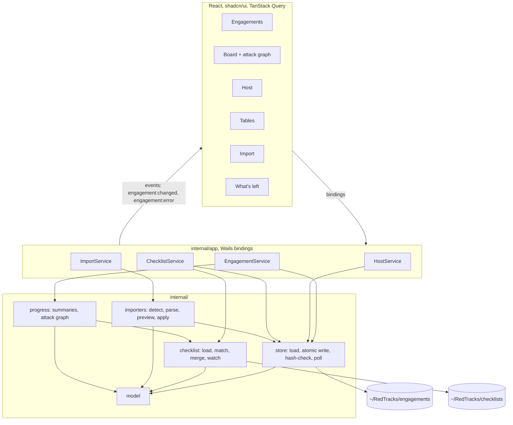
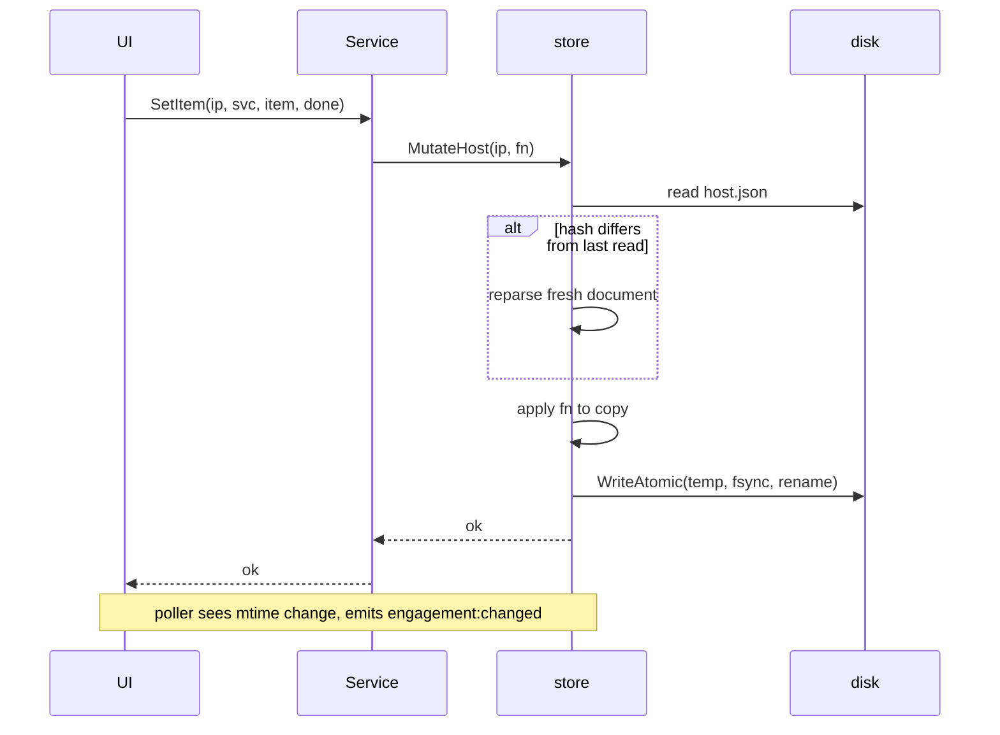

# feat: RedTracks slice one, structured target tracker

## Summary

Build RedTracks, a macOS desktop app that tracks hosts, services, per-service checklists, credentials, findings, and flags for OffSec labs and exams, stored as plain JSON files under `~/RedTracks`. Slice one imports output from ten tools through nine parsers (rustscan emits nmap XML), shows a "what's left" view, and renders an autogenerated Mermaid attack graph. This plan indexes the work as eighteen implementation units; exact Go signatures, test assertions, and fixtures for each unit live in `docs/superpowers/plans/2026-10-12-redtracks-slice1.md` (the detailed plan), which implements the approved spec at `docs/superpowers/specs/2026-10-12-redtracks-slice1-design.md`.

## Problem Frame

Templates in a general note app do not help an operator remember what has been tried on a host at hour nineteen of an exam. The operator needs structure as data: which ports have untouched checklists, which credentials were never tried on a host, which flags are missing, how a host is reached. The files must stay readable and editable in vim if the app breaks, and the app must keep faith with external edits. See the spec for the full decision record.

---

## Requirements

**Storage and trust**

- R1. All state lives as JSON files in one folder per engagement under `~/RedTracks/engagements/`, readable and hand-editable without the app.
- R2. Every write is atomic (temp file, fsync, rename) and goes through one function.
- R3. A mutation re-reads the file first; if it changed on disk, the mutation is reapplied to the fresh document so both the external edit and the app's edit land.
- R4. Files that fail to parse are reported with path, line, and column and are never overwritten.
- R5. Saving notes over an externally changed `notes.md` is refused with a conflict the UI can resolve; no silent clobber.
- R6. External changes are picked up by a two-second mtime poll; parse failures during polling surface as a banner, not silence.
- R7. Host folder names come only from IPs that pass `netip.ParseAddr`.

**Domain model**

- R8. An engagement has a type (lab, oscp, osai, custom) that sets default flag types and points; osai is ai_vector 15, trad_vector 10, proof 5; lab and oscp are local 10 and proof 10.
- R9. A host has IP, hostname, OS, status (untouched, enumerating, foothold, user, root, done), tags, access paths, services, flags, and a host-level checklist state.
- R10. A service has port, protocol, an open service type string, product, version, web paths, and a checklist state keyed by stable item IDs.
- R11. Credentials, users, shares, loot, and findings are engagement-wide tables with host references; credentials carry a found-on host (`foundOnHostId`) and track `worksOn` and `triedOn`. Every table row can be edited and deleted from the UI.

**Checklists**

- R12. Checklist definitions are JSON files under `~/RedTracks/checklists/`, matched to services by type and to hosts by OS, with stable item IDs so edits do not orphan history.
- R13. A sample set of ten definitions ships embedded and is copied on first launch only, never overwritten.
- R14. Definitions hot-reload while the app runs; a bad definition file never blocks startup.
- R15. Commands in definitions substitute `$T` and `$D` only, and refuse IPs or domains that fail validation.

**Importers**

- R16. Dropping a file detects the tool from content: nmap XML (also what rustscan emits), masscan JSON, ffuf JSON, feroxbuster JSONL, gobuster text, nikto JSON, nuclei JSONL, enum4linux-ng JSON, netexec text with ANSI colour stripped.
- R17. Every import shows a preview with `new`, `fills`, and `duplicate` badges and resolves hosts by IP, hostname, or operator choice before anything is written.
- R18. Merge never overwrites an operator-set service type, deduplicates web paths, findings, users, and shares, and copies the raw file under the host's `imports/`.

**Progress and graph**

- R19. Per host the app computes missing flags, untouched services, open items, untried credentials, and missing access path, and sorts the board so the most neglected host is on top.
- R20. The board renders a Mermaid attack graph of hosts and access paths, with labels escaped and Mermaid in strict security mode.

**Screens**

- R21. Six screens: Engagements, Board, Host, Tables, Import, What's left, plus a command palette on cmd+k and space to toggle a focused checklist item.
- R22. Every screen has defined loading, empty, and error states; colour is never the only signal.

**Build and verification**

- R23. Go 1.27 and Wails `v3.0.0-beta.28` are pinned through `mise.toml` and `go.mod`; pnpm, task, and staticcheck float in slice one.
- R24. Go packages under `internal/` reach 80% line coverage; one Playwright happy path runs against the Wails server build.

---

## Key Technical Decisions

- **Wails v3 beta with Go backend, React and shadcn/ui frontend:** Go holds every tested behaviour; generated TypeScript bindings keep the frontend honest. Pinned to one beta tag; bumps are their own commit.
- **Server build is a dev and e2e artifact only:** its bindings are reachable over plain HTTP by any local process or by a hostile page the operator browses during an exam, with no authentication. It is not distributed and the README says so. A browser fallback or Linux path would need Host and Origin checks plus a per-launch token first.
- **Plain JSON files, no database:** the files are the interface during an exam. JSON over YAML to avoid whitespace mistakes; `encoding/json` with indentation and struct-ordered fields keeps diffs small.
- **Hash-check-and-reapply mutations:** the store keeps a SHA-256 per file, re-reads before writing, and applies the mutation closure to the fresh document. Callers never hold pointers into store state.
- **Editor-owned notes baseline:** `ReadNotes` returns text plus hash; `WriteNotes` takes the hash the editor loaded and fails with a conflict when the on-disk hash differs. The notes query is not invalidated by the poller; the editor re-reads on each `engagement:changed` event and refuses to adopt the result while dirty.
- **mtime polling, not a watcher library:** fifteen files per engagement; polling costs nothing and adds no dependency. Marked as a known ceiling.
- **Importers are functions, not plugins:** one parser file, one sniff rule, one fixture per tool; `Parse(data []byte)` detects then dispatches.
- **Partial-record updates only:** update methods replace scalar fields and never touch `WebPaths`, `Checklist`, `WorksOn`, or `TriedOn`, so a stale form cannot revert concurrent changes.
- **Target-controlled strings are hostile:** hostnames, domains, and OS strings from scan output are validated before becoming paths, shell command substitutions, or Mermaid labels.
- **`$D` source:** the host's hostname domain part when it contains a dot, otherwise an optional `Domain` on the engagement set at creation.
- **Dark theme only, last-opened engagement not remembered:** the app lives beside a Kali VM; reopening an engagement is one click.

---

## High-Level Technical Design



Mutation path for host, engagement, table, and import writes. Notes saves do not take this path: `WriteNotes` compares the on-disk hash with the base hash the editor loaded and fails with a conflict when they differ, so an external edit is never reapplied over.



---

## Output Structure

```text
redtracks/
  main.go
  mise.toml
  Taskfile.yml
  checklists/            embedded sample definitions + _readme.md
  internal/
    model/
    store/
    checklist/
    importers/           one file per tool + testdata/
    progress/
    app/                 Wails services, log
  frontend/
    src/
      lib/               api.ts, query.ts
      components/        AppShell, Mermaid, CommandPalette, QueryStates, RequireEngagement, MarkdownView
      features/
        engagements/  board/  host/  tables/  import/  left/
    e2e/
    bindings/            generated, gitignored
```

---

## Implementation Units

Each unit maps to the same-numbered task in the detailed plan, which carries exact signatures, test names with assertions, and commands. Dependencies are strict: a unit consumes the interfaces its predecessors produce.

### U1. Scaffold, toolchain, and build pipeline

- **Goal:** A repo where build, lint, and test tasks succeed with no application code.
- **Requirements:** R23
- **Dependencies:** none
- **Files:** `mise.toml`, `LICENSE`, `.gitignore`, `README.md`, `main.go`, `go.mod`, `Taskfile.yml`, `frontend/` (from `wails3 init -t react`), spec section 12 amendment
- **Approach:** Wails React template at repo root, module `github.com/unclesp1d3r/redtracks`, pnpm, Tailwind, shadcn components including sonner and skeleton, dark theme forced with a chosen palette, Taskfile `test`, `lint`, `e2e` tasks.
- **Test scenarios:** Test expectation: none -- scaffolding; verification is the build, lint, and test tasks exiting 0 and a window opening.
- **Verification:** `wails3 task build`, `lint`, `test` exit 0; `bin/redtracks` opens a dark window titled RedTracks.

### U2. Model package

- **Goal:** All domain types with camelCase JSON tags, ID generation, default flag sets.
- **Requirements:** R8, R9, R10, R11
- **Dependencies:** U1
- **Files:** `internal/model/model.go`, `ids.go`, `flags.go`; test `internal/model/model_test.go`
- **Approach:** Types only, no logic beyond `NewID` (`crypto/rand.Text`) and `DefaultFlagTypes`. `EngagementMeta` carries optional `Domain`.
- **Test scenarios:** default flag types per engagement type with exact points; 1000 IDs distinct; `Host` JSON field order is id, then accessPaths before services before flags.
- **Verification:** package tests pass.

### U3. Atomic write and positioned parse errors

- **Goal:** The single write path and a `ParseError` with line and column.
- **Requirements:** R2, R4
- **Dependencies:** U1
- **Files:** `internal/store/atomic.go`, `parse.go`; tests `atomic_test.go`, `parse_test.go`
- **Approach:** temp file in the same directory, fsync, rename; JSON syntax and type errors mapped from byte offset to line and column.
- **Test scenarios:** write then read back equal; no temp file left; unwritable directory leaves the original intact; malformed JSON reports line 3; type mismatch reports a nonzero line.
- **Verification:** tests pass.

### U4. Engagement store with hash-checked mutations

- **Goal:** Load an engagement folder, mutate through closures with reapply-on-external-change, notes with conflict detection, raw import saving.
- **Requirements:** R1, R3, R4, R5, R6, R7
- **Dependencies:** U2, U3
- **Files:** `internal/store/store.go`, `layout.go`, `notes.go`; test `store_test.go`; fixture `internal/store/testdata/pg-sample/`
- **Approach:** per-file SHA-256; `Mutate*` methods re-read, reparse if changed, apply to a copy, write atomically. Path helpers reject IPs failing `netip.ParseAddr`. `ReadNotes` returns text and hash; `WriteNotes` takes the base hash. `Reload` keeps the last good copy on parse failure and returns the error.
- **Execution note:** Implement test-first; these tests are the trust contract for exam use.
- **Test scenarios:** fixture loads one host; missing files are fine; mutation round-trips with two-space indent; external tag edit plus app hostname edit both persist; corrupt creds file refuses to write and keeps bytes; IP-vs-folder mismatch is an error naming both; notes conflict with a second read in between; `AddHost` creates folder and rejects duplicates; traversal IPs rejected by `AddHost` and `SaveImport`; `SaveImport` naming pattern; `Reload` reports changed files and keeps last good on parse error.
- **Verification:** tests pass under `-race`.

### U5. Engagement listing, creation, and the poller

- **Goal:** Root resolution, listing and creating engagements under `root/engagements`, and the mtime poll with change and error callbacks.
- **Requirements:** R1, R6, R8
- **Dependencies:** U4
- **Files:** `internal/store/root.go`, `poll.go`; tests `root_test.go`, `poll_test.go`
- **Approach:** `REDTRACKS_HOME` or `~/RedTracks`; validate the raw name before slugifying; create `engagement.json` with domain and flag types, `notes.md`, `hosts/`. Poll is a ticker over `Reload`.
- **Test scenarios:** env override; layout and osai points written; `""`, `../x`, `a/b` rejected creating nothing; non-engagement dirs skipped; poll delivers a changed path within 500ms and stops on cancel; poll reports a `*ParseError` on a corrupted file.
- **Verification:** tests pass under `-race`.

### U6. Checklist definitions, matching, watcher, and the shipped set

- **Goal:** Load and match definitions, merge with state, substitute commands safely, install defaults once, hot-reload, and ship ten sample definitions.
- **Requirements:** R12, R13, R14, R15
- **Dependencies:** U2, U3
- **Files:** `internal/checklist/checklist.go`, `install.go`; `checklists/embed.go`, `_readme.md`, ten `checklists/*.json`; test `internal/checklist/checklist_test.go`
- **Approach:** match by service type or host OS; state keyed by item ID with missing state meaning todo; duplicate item IDs across files are an error naming both files; `Substitute` validates IP and domain; `Watch` is an mtime ticker that keeps the previous set on error.
- **Test scenarios:** load two files; duplicate ID error names both; service and host matching; merge defaults and orphan state; substitution happy path and shell-metacharacter rejection; install once and never overwrite; watch reloads on change and keeps the last good set on error; shipped set is exactly ten definitions with five to ten items each.
- **Verification:** tests pass.

### U7. Importer contract, detection, and nmap

- **Goal:** The normalised `Result` type, content sniffing, dispatch, and the nmap XML parser with a real captured fixture.
- **Requirements:** R16, R7
- **Dependencies:** U2
- **Files:** `internal/importers/result.go`, `detect.go`, `parse.go`, `nmap.go`; tests `detect_test.go`, `nmap_test.go`; fixtures `testdata/nmap-localhost.xml` (captured from local nmap), `nmap-subnet-down.xml`, `garbage.bin`
- **Approach:** `Parse` detects then dispatches through a parsers map; drops results whose IP fails validation and counts them. Only open ports become services; down hosts are skipped; OS guess lowercased from the first osmatch.
- **Test scenarios:** detection table over all fixtures plus garbage naming tools tried; localhost parse yields tcp services with ports; down host and traversal address skipped with `Dropped == 1`; OS guess linux from the hand-written fixture and empty without osmatch.
- **Verification:** tests pass.

### U8. Port and web importers

- **Goal:** masscan, gobuster, ffuf, feroxbuster parsers.
- **Requirements:** R16
- **Dependencies:** U7
- **Files:** `internal/importers/masscan.go`, `gobuster.go`, `ffuf.go`, `feroxbuster.go`; test `web_test.go`; four hand-written fixtures marked for replacement with Kali captures
- **Approach:** web parsers set `URL` with scheme, host, and port; gobuster has neither IP nor URL and resolves through the operator picker.
- **Test scenarios:** masscan two IPs with empty type; gobuster three paths, banner lines ignored, empty URL asserted; ffuf URL with FUZZ stripped and status and length mapped; feroxbuster only response lines, URL keeps port 8080.
- **Verification:** tests pass; detection table extended.

### U9. Vulnerability and SMB importers

- **Goal:** nikto, nuclei, enum4linux-ng, netexec parsers.
- **Requirements:** R16
- **Dependencies:** U7
- **Files:** `internal/importers/nikto.go`, `nuclei.go`, `enum4linux.go`, `netexec.go`; tests `vuln_test.go`, `smb_test.go`; four hand-written fixtures
- **Approach:** findings carry port; nikto severity info, nuclei severity from template; users and shares from enum4linux-ng maps and netexec lines; the netexec parser strips ANSI escape sequences before matching; domains with whitespace or control characters dropped.
- **Test scenarios:** nikto finding count equals vulnerabilities with port 80; nuclei grouped by host with lowercased severity; enum4linux users, shares with `mapping/listing`, OS family; netexec hostname DC01, windows OS, users with domain split, shares with access; a netexec fixture wrapped in ANSI colour codes parses identically.
- **Verification:** tests pass; detection covers all nine formats plus garbage.

### U10. Import preview and merge

- **Goal:** Resolve hosts, badge rows, merge per spec rules, save raw files.
- **Requirements:** R17, R18
- **Dependencies:** U4, U7, U8, U9
- **Files:** `internal/importers/merge.go`; test `merge_test.go`
- **Approach:** resolve by IP, URL host against IP or hostname, then overrides (`ip` or `ip:port`); results with neither are unresolved with the tool name as key; unresolved hosts are never written and are reported back. Existing service type wins; imports fill empty fields only.
- **Test scenarios:** new host rows; fills badge and type preserved; duplicate web path; URL resolves by hostname; unresolved writes nothing and creates no imports file; override attaches to port 80; gobuster override with port creates the service; double apply deduplicates findings and users; raw file saved.
- **Verification:** tests pass under `-race`.

### U11. Progress and attack graph

- **Goal:** What's-left summaries, board ordering, Mermaid attack graph with escaped labels.
- **Requirements:** R19, R20
- **Dependencies:** U2, U6
- **Files:** `internal/progress/progress.go`, `graph.go`; tests `progress_test.go`, `graph_test.go`; golden `testdata/graph.golden.mmd`
- **Approach:** pure functions; node IDs from IPs; class per status; quoted labels with quotes, angle brackets, and newlines neutralised and cut at 60 characters.
- **Test scenarios:** missing flags for osai; untouched services only with a matching definition; untried credentials exclude found-on and tried-on hosts; no-access-path rule; board order by points then checklist ratio; golden graph byte-equal; hostile hostname and method produce no unescaped sequences.
- **Verification:** tests pass.

### U12. Wails services, logging, and bindings

- **Goal:** Four thin services bound to the frontend, rotating log, poller lifecycle, checklist watcher, generated TypeScript bindings.
- **Requirements:** R5, R6, R14, R15, R17, R21
- **Dependencies:** U5, U6, U10, U11
- **Files:** `internal/app/app.go`, `engagement_service.go`, `host_service.go`, `import_service.go`, `checklist_service.go`, `log.go`; `main.go`; tests `log_test.go`, `services_test.go`
- **Approach:** `App` holds a mutex-guarded store and a cancel func; `Open` accepts only direct children of `root/engagements`, cancels the previous poller, emits `engagement:changed` and `engagement:error`. The checklist watcher's errors emit `engagement:error` too, naming the definition file and position. Update methods replace scalar fields only; every table has update and delete methods. `PreviewData` takes base64 with a 20 MB cap; `Discard` drops a pending token. `New` never fails on a bad definition. Secrets and flags are never logged. `main.go` enables server options only under the `server` build tag.
- **Test scenarios:** log rotates at 5 MB; `SetItem` persists; `MarkTried` appends once and `works` also appends to `worksOn`; preview then apply creates the host and a reused token errors; stale `UpdateService` keeps a ticked item; opening a second engagement stops the first poller; defaults installed on first run; bad definition does not prevent startup.
- **Verification:** `generate:bindings`, `build`, `lint`, `test` exit 0 and the four binding files plus `models.ts` exist.

### U13. Frontend shell, Engagements, Board with attack graph

- **Goal:** Routing with an engagement guard, query client with event-driven invalidation and shared states, command palette, Engagements and Board screens including Add host.
- **Requirements:** R20, R21, R22
- **Dependencies:** U12
- **Files:** `frontend/src/lib/api.ts`, `query.ts`, `App.tsx`, `components/AppShell.tsx`, `Mermaid.tsx`, `CommandPalette.tsx`, `QueryStates.tsx`, `RequireEngagement.tsx`, `features/engagements/*`, `features/board/*`; tests `Mermaid.test.tsx`, vitest config
- **Approach:** `AppShell` has a persistent left nav with Board, Tables, Import, What's left, and a link back to Engagements. The palette lists hosts, services, a "Go to" entry per screen, and Add host. sonner toasts for mutation errors except silent mutations; query failures render through `QueryStates`; `engagement:error` shows a banner for both store and checklist-definition errors; Mermaid initialised strict and dark with DOMPurify on output; board sorted by neglect with text-plus-icon flag chips.
- **Test scenarios:** Mermaid falls back to raw text on render error; manual check that creating an osai engagement lands on an empty Board with Add host and Import, and that `engagement.json` exists under `engagements/`.
- **Verification:** vitest and typecheck pass; app opens on Engagements.

### U14. Host screen

- **Goal:** Services, checklists with row layout and scoped space shortcut, status, flags, access paths, notes editor with conflict handling.
- **Requirements:** R5, R9, R10, R12, R15, R21, R22
- **Dependencies:** U13
- **Files:** `frontend/src/features/host/*`, `components/MarkdownView.tsx`; tests `Checklist.test.tsx`, `NotesEditor.test.tsx`
- **Approach:** layout top to bottom: header with status and flags pinned, access paths, a two-pane body with the service list on the left and the selected service's checklist, web paths, and findings on the right (host checklists in a tab beside Services), and notes in a collapsible lower region. Status Select, flag popovers, access path dialog with via-host and credential selects; checklist rows expand to hint, commands, and a note textarea; the copy button passes the derived domain; the notes editor owns its base hash and dirty flag and never adopts a refetch while dirty.
- **Test scenarios:** space toggles done and back on a row and is ignored inside the note textarea; dirty editor keeps its buffer and shows the banner on refetch, clean editor adopts new text; manual check that ticking an item changes `host.json` within two seconds.
- **Verification:** vitest and typecheck pass; manual flow holds.

### U15. Tables screen

- **Goal:** Credentials, users, shares, loot, findings tables with tried and works chips and masked secrets.
- **Requirements:** R11, R21, R22
- **Dependencies:** U13
- **Files:** `frontend/src/features/tables/*`
- **Approach:** one tab per table; every row opens the same dialog in edit mode and has delete with a confirm step. Dialog fields: credentials (username, secret, kind, domain, found-on host, notes), users (name, domain, host, notes), shares (host, name, access, notes), loot (host, label, path, notes), findings (host, service, title, severity, source, evidence, status). Chips carry text labels; per-row reveal toggle on secrets that re-masks after ten seconds, with a copy button.
- **Test scenarios:** covered by the U18 Playwright step that adds a credential through this screen and asserts `creds.json`.
- **Verification:** typecheck passes; adding a credential writes `creds.json`.

### U16. Import screen

- **Goal:** Drop zone with base64 encoding and size cap, preview with badges, host and port resolution, skip-unresolved, cancel.
- **Requirements:** R16, R17, R21, R22
- **Dependencies:** U13
- **Files:** `frontend/src/features/import/*`; tests `PreviewTable.test.tsx`, `encode.test.ts`
- **Approach:** unknown-format errors render inline and keep the zone ready; detected tool shown; unresolved entries get a host select and, without a URL, a port input; success toast reports new, filled, and skipped counts.
- **Test scenarios:** preview groups by host with three badge texts; base64 helper encodes `[0,255,10]` to `AP8K`; manual check that the nmap fixture creates host `127.0.0.1` and a raw file under `imports/`.
- **Verification:** vitest and typecheck pass; manual flow holds.

### U17. What's left screen

- **Goal:** One card per host in board order with the five signals, each linking into the Host screen.
- **Requirements:** R19, R21, R22
- **Dependencies:** U13
- **Files:** `frontend/src/features/left/*`
- **Approach:** consumes `Summaries`; hosts with nothing left show one line and sort last.
- **Test scenarios:** Test expectation: none -- read-only projection of U11 output, which is unit tested; manual check that ticking all items removes a service from the list.
- **Verification:** typecheck passes; manual flow holds.

### U18. End-to-end test against the server build and release checklist

- **Goal:** One Playwright happy path, coverage gate, README.
- **Requirements:** R24
- **Dependencies:** U14, U15, U16
- **Files:** `frontend/playwright.config.ts`, `frontend/e2e/happy-path.spec.ts`, `Taskfile.yml`, `README.md`, `.gitignore`
- **Approach:** at the top of `playwright.config.ts`, create a temp dir only when `REDTRACKS_E2E_HOME` is unset and store its path in that variable; workers inherit the main process env, so the spec reads the same path. `webServer` runs `bin/redtracks-server` with `REDTRACKS_HOME` set to that path and `WAILS_SERVER_PORT=8080`.
- **Test scenarios:** create a lab engagement, import the nmap fixture, open the host, tick an item, add a credential on Tables, then assert `host.json` has a done item and `creds.json` has the credential.
- **Verification:** `wails3 task e2e` passes; `internal/` coverage at or above 80%; lint clean. Operator acceptance before an importer is trusted in an exam: run it once against real output from the Kali VM; any mismatch becomes a fixture replacement and a parser fix.

---

## Scope Boundaries

**Deferred to follow-up work**

- Evidence capture, cross-engagement knowledge base, report generation, and the Linux build each get their own spec.
- 0600 file modes and 0700 directories for engagement files.
- Pinning `pnpm`, `task`, and `staticcheck` versions in `mise.toml`.
- eslint in the lint task; the spec lists it, slice one runs `tsc` only.
- Credential-reuse Mermaid graph.
- Discovery of host folders added or removed by hand while the app runs.

**Outside this product's identity**

- Multi-user, sync, cloud storage, or any network call.
- Automated exploitation or scanning from inside the app.

---

## Risks & Dependencies

- **Wails v3 beta churn:** pinned to `v3.0.0-beta.28`; API drift is absorbed in a dedicated bump commit, never mid-feature.
- **Hand-written fixtures may not match real tool output:** nine of ten tools are not installed on the build machine. Parsers are table-tested so swapping a fixture is cheap, netexec tolerates ANSI colour, and U18 names a real-output run per tool as the operator's acceptance step before exam use.
- **Hash re-read then rename is not atomic against an external writer:** the window is milliseconds and the operator is the only other writer; accepted.
- **Desktop file drop may need the Wails `EnableFileDrop` window option:** the file picker is the fallback and the e2e path uses upload, so the desktop drop is verified manually in U16.
- **Import apply is many writes:** a mid-way failure leaves a partial import; merge is idempotent so a retry completes it.

---

## Sources

- Approved design spec: `docs/superpowers/specs/2026-10-12-redtracks-slice1-design.md`
- Detailed task plan with signatures, tests, and commands: `docs/superpowers/plans/2026-10-12-redtracks-slice1.md`
- Wails v3 service and server-mode behaviour verified against `github.com/wailsapp/wails/v3@v3.0.0-beta.28` source (`pkg/application/application_server.go` for `WAILS_SERVER_PORT` and the `localhost:8080` default).
- OSAI exam structure (two chains into one DC, flag types and points) from a public candidate write-up at tech.leonardotamiano.xyz/posts/osai-certification.html.
