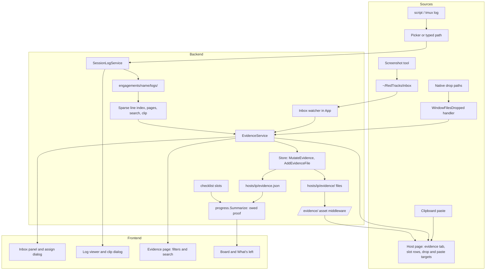
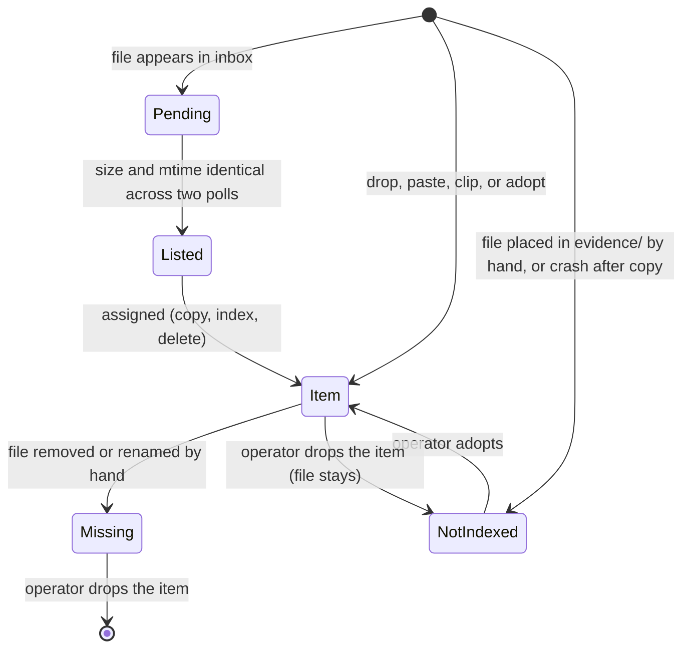

# Evidence Capture - Plan

## Goal Capsule

- **Objective:** During an exam-length CTF session the operator can see what proof each host still owes, attribute every screenshot and command output to the host and step it proves at the moment it is captured, and find the proof for any step in seconds, all from files inside the engagement folder.
- **Means:** A per-host evidence ledger of plain files plus a small index, fed by a watched inbox, direct drop and paste, and clipped terminal logs, with proof slots declared in the checklist files (KTD1, KTD2, KTD5).
- **Product authority:** This plan owns evidence capture only. Report generation, the credential-reuse graph, the housekeeping items, and the cross-engagement knowledge base are surrounding areas, not active scope. When sections disagree, a Requirement wins on product behaviour and a Key Technical Decision wins on mechanism within its cited Requirements; units override neither.
- **Execution profile:** Implement unit by unit in the order of the Unit Index, Go core packages before services before frontend, with every unit green under `just test` and `just lint` before the next starts. Native drop, native dialog, and clipboard paste are checked by hand on at least macOS, since the Playwright suite runs the server build.
- **Stop conditions:** Stop and report if a settled decision proves infeasible (for example native file drop cannot deliver paths on a target platform), if the evidence index design would require rewriting an operator's file, or if the Wails pin would have to move.
- **Who finishes:** `ce-work` implements and verifies; the operator reviews the PR and merges.
- **Open blockers:** None.

---

## Product Contract

**Product Contract preservation:** changed, additive only. R25 through R33, AE11 through AE16, and five unlabeled Key Decisions were added from the confirmed scoping synthesis; R1 through R24 and AE1 through AE10 are unchanged in meaning. R7 gained one qualifier (per-service scope) that R25 now owns.

### Summary

Evidence becomes a first-class part of each host: every screenshot or text snippet is an evidence item stored as a plain file under the host, with its capture time, an optional caption, and links to the proof slots, findings, flags, and access paths it proves. Proof slots declared in the checklist files say what each host owes, so missing proof surfaces beside untouched checklist items. Captures arrive from a watched inbox folder, from drop or paste on the host screen, from pasted command output, and from ranges clipped out of imported terminal logs; a browse view lets the operator wade through all of it by host, by what it proves, by time, and by text.

### Problem Frame

RedTracks exists to pull knowledge into one place during CTF-style engagements, organize it, and make it easy to wade through. Slice one did that for hosts, services, checklists, credentials, and findings. Proof is still outside the system. The operator captures it the way the tools allow: tmux or `script` logging for the terminal, and a screenshot tool saving into a folder. The knowledge arrives faster than it can be organized, so at report time three costs land at once. Working out which screenshot proves which host, service, and command takes the longest. Proof that was never taken is discovered only when the report needs it. The one successful command and its output are buried in hours of terminal log. CTF work is mostly surveying and pivoting, so the flags are often not known in advance; what must be tracked is everywhere the operator has been and how to get back there, and the proof of a foothold matters as much as the proof of a flag. Each of these is a reconstruction job done under exam time pressure, and each is a case of knowledge that was captured but never organized.

### Key Decisions

- **Evidence capture is slice two.** It is the deferred area that makes the next exam measurably easier and it is what a later report consumes. (session-settled: user-directed — chosen over report generation, the credential-reuse graph with housekeeping, and the cross-engagement knowledge base: a report is thin without evidence to put in it.)
- **Required-proof slots live in the checklist files.** The operator already edits those files, and the same match rules put the right slots on the right hosts and services. Governs R6, R7, R8, R9, R25, R26. (session-settled: user-directed — chosen over flag-only proof, free attachments with no completeness rule, and built-in exam rules: it answers "did I capture everything" without hard-coding one exam's rules.)
- **Two capture paths: a watched inbox and direct drop or paste.** The inbox fits the flow of a live session with an external screenshot tool; direct drop and paste covers one-offs without leaving the host screen. Governs R10 through R15, R27, R28. (session-settled: user-directed — chosen over a single path and over reference-only entries that never copy files: attribution has to happen while the capture is fresh, and the engagement folder stays self-contained.)
- **Text proof comes from pasted snippets and from clipping imported logs.** Paste serves the live session; clipping serves the after-the-fact dig through a scripted window. Governs R16 through R19, R31. (session-settled: user-directed — chosen over paste alone, clipping alone, and leaving text proof in `notes.md`: both pains were named and notes are not attributable to a slot or flag.)
- **All four pieces ship together.** Slots, inbox, paste, and log clipping were weighed as separate cuts and judged to be one feature: without any one of them the report step is still reconstruction. (session-settled: user-directed — chosen over shipping slots plus inbox, slots plus direct capture, or clipping alone first.)
- **Imported logs are copied into the engagement uncompressed.** Governs R16. (session-settled: user-directed — chosen over reading the log in place and over a size-capped copy: a self-contained, reproducible engagement folder is worth the disk.)
- **Evidence is a per-host ledger that slots, findings, flags, and access paths link into.** One capture can prove several things, an unassigned capture is a natural state, each host gets a timeline, and a later report can walk the ledger. Governs R1, R4, R20. (session-settled: user-directed — chosen over attachments stored on each record and over an engagement-wide journal: the ledger carries the ordering benefit of a journal without turning the product into a notebook.)
- **The inbox is one folder for the whole RedTracks home.** Screenshot tools save to a fixed path, so the inbox cannot be per engagement; assignment moves a file into the open engagement. Governs R10, R11, R28.
- **Evidence files are written once and never rewritten.** They are the operator's files in the same sense `notes.md` is. Governs R2, R5, R29.
- **Capture time is recorded on every item.** It is what makes a host's evidence read as a timeline and what a report will order by. Governs R3.
- **Completeness is the slots' job alone.** A flag or access path with no linked evidence is visibly unproven, but the app does not inspect what an image contains, so the "flag and `ip addr` in one frame" rule stays with the operator. Governs R7, R8.
- **Findability is a requirement, not a by-product.** The project's purpose is making captured knowledge easy to wade through, so browsing and search across evidence are in scope. Governs R20, R21.
- **Logs arrive through a file picker, not drag and drop.** The existing drop path decodes the whole file in memory and refuses anything over 20 MB; a session log exceeds that. Governs R17, R32.
- **A slot on a service checklist is owed once per matching service.** Host-level slots are owed once per host, mirroring how checklist state is already kept per host and per service. Governs R25.
- **Missing slots and missing flags together are "owed proof" at the top of the board sort.** In CTF work the flags are often unknown, so proof owed is a better neglect signal than flags alone. Governs R8, R26.
- **Shipped slots reach existing installs by adding missing bundled checklist files once.** Files the operator already has are never touched, which keeps the "never overwritten" promise while closing the gap for the one real user. Governs R9.
- **Accepted evidence types are PNG, JPEG, GIF, WebP, and UTF-8 text.** Anything else is refused with a reason; keeping SVG and PDF out also keeps active content away from the image route. Governs R30.
- **Identical files are stored again, with a warning.** Deduplication would silently destroy a capture the operator made on purpose; a warning on an identical hash within the host is enough. Governs R27.

<!-- ce-section: work-relationships -->

### How This Work Fits Together

This plan covers evidence capture. The breakdown below is the current understanding of slice two and after, not a committed roadmap; a later plan may revise, split, merge, or discard any of it.

- Report generation
  - Depends on this plan: a report walks each host's evidence ledger in capture order and needs slots to know what is missing.
  - Still to decide: output format and whether the report is per host or per engagement.
- Credential-reuse graph, hand-added host folder discovery, 0600/0700 file modes, eslint in the lint gate, Linux build
  - Can proceed independently of this plan.
  - Shares the checklist and store conventions this plan extends; no ordering constraint.
- Cross-engagement knowledge base
  - Can proceed independently of this plan.
  - Still to decide: whether captured evidence is part of what carries across engagements.

### Requirements

**Evidence items and storage**

- R1. An evidence item is one file, an image or plain text, stored under its host inside the engagement folder, together with its capture time, an optional caption, and the list of slots, findings, flags, and access paths it proves.
- R2. The app writes each evidence file once and never modifies it afterwards.
- R3. Every item records when it was captured: the file's own modification time for a file that came from the inbox or a drop, the moment of capture for a paste or a clip; items are presented in capture order.
- R4. One item can be linked to any number of proof slots, findings, flags, and access paths on its host, and links can be added or removed after capture.
- R5. An evidence file that is removed or renamed by hand shows its item as missing; the app does not recreate the file, and the operator can drop the item.

**Proof slots and completeness**

- R6. A checklist definition can declare proof slots alongside its items, each with a title and a hint, matched to hosts and services by the same match rule as items.
- R7. A slot is filled when at least one evidence item on that host is linked to it within the scope R25 defines, and missing otherwise.
- R8. Missing slots count as outstanding work in the board ordering and appear in What's left beside untouched checklist items.
- R9. The bundled host-level checklists declare slots for the OffSec exam proofs, the `local.txt` proof, the `proof.txt` proof, and an interactive shell, plus a foothold slot for how the host was reached and how to get back, each described in its hint; operators edit or remove them like any checklist content, and an existing install receives any bundled checklist file it does not yet have without any existing file being changed.

**Inbox capture**

- R10. RedTracks watches one inbox folder under the RedTracks home and, while an engagement is open, lists every file in it as unassigned evidence with an image preview or the first lines of text.
- R11. Assigning an unassigned file names a host and zero or more slots, findings, flags, or access paths on it; the file moves under that host and becomes an item.
- R12. A file left unassigned stays in the inbox across restarts, because the inbox is the folder's contents and nothing else.
- R13. The inbox shows new files within the same polling interval the engagement files use, without the operator refreshing.

**Direct capture**

- R14. On a host screen the operator can drop image or text files, or paste an image or text from the clipboard, onto the host itself or onto a specific slot, finding, flag, or access path; the result is an item linked to whatever it was dropped on.
- R15. A caption can be added to any item at capture time or later.

**Text proof and terminal logs**

- R16. The operator can import a terminal log into the open engagement; it is copied unchanged into the engagement folder as an engagement-level source and is not itself evidence.
- R17. Log import goes through a native file picker and is not subject to the 20 MB cap that governs scan-output imports.
- R18. The app shows an imported log with terminal colour codes removed, lets the operator search its text, select a range of lines, and save that range as a text item on a chosen host, linked as in R11; the item records which log and which line range it came from.
- R19. Pasted command output and log clips are stored as plain text files that read correctly outside the app.

**Browsing and findability**

- R20. Each host screen lists its evidence in capture order with what each item proves, and each slot, finding, flag, and access path shows the items linked to it, with an unproven flag or access path marked as such.
- R21. An engagement-wide evidence view filters by host, by what an item proves (a slot, a finding, a flag, an access path, or nothing yet), and by capture time, and searches captions and the contents of text items.
- R22. Opening an item shows the image or text inside the app and can reveal the file in the operating system's file manager.

**Safety**

- R23. Evidence file names are derived from capture time and kind, never from captions, hostnames, or any other target-controlled string.
- R24. Captions, pasted text, and log contents are rendered as text only; they are never shell-substituted, rendered as HTML, or placed in a Mermaid label.

**Scope, completeness, and ordering rules**

- R25. A slot declared in a definition that matches services is owed separately for each matching service on a host and is filled only by an item linked to that slot and that service; a slot declared in a definition that matches hosts is owed once per host.
- R26. The board orders hosts by owed proof first, where owed proof is the share of missing flags and missing slots together, then by lowest checklist completion, then by IP.

**Inbox and file integrity rules**

- R27. A dropped or inbox file is accepted when its content is PNG, JPEG, GIF, WebP, or UTF-8 text, and is refused with a named reason otherwise; an accepted file whose bytes already exist as an item on the same host is stored again and the operator is warned.
- R28. The inbox lists a file only once its size and modification time have been unchanged across two consecutive polls, ignores dotfiles, directories, and temporary names, and an assignment is refused when a different engagement was opened after the list was shown.
- R29. Dropping an item removes its index entry and leaves its file on disk; a file in a host's evidence folder with no index entry is shown as not indexed with a one-step adopt, and a link whose target no longer exists is shown as removed and can be unlinked.

**Type, log, and server-mode rules**

- R30. SVG, PDF, and any other type outside R27's list are never stored as evidence or served by the image route.
- R31. An imported log is a snapshot of the file at import time, is read in pages without loading the whole file, and a clip is limited to 5,000 lines; pasted text and clips have terminal control sequences removed before they are stored.
- R32. In the server build, where no native dialog exists, log import accepts an absolute path to a regular file typed by the operator.
- R33. In the server build, "reveal in file manager" is replaced by copying the file's path, and the inbox and evidence screens are reachable only while an engagement is open.

### Key Flows

- F1. Assign from the inbox during a live session
  - **Trigger:** The screenshot tool saves a file into the inbox while a host is being worked.
  - **Steps:** The inbox count rises on the next poll; the operator opens the inbox, sees the preview, picks the host and the slot or flag it proves, and confirms; the file moves under the host and the slot shows as filled.
  - **Outcome:** The capture is attributed within a minute of being taken and the host's owed proof shrinks.
  - **Covered by:** R3, R7, R10, R11, R13, R28.
- F2. Paste proof straight onto a flag
  - **Trigger:** The operator has `proof.txt` and `ip addr` in one terminal frame and takes a screenshot to the clipboard.
  - **Steps:** On the host screen they paste onto the flag row; an item is created, linked to the flag, and offered a caption.
  - **Outcome:** The flag shows its proof; no file naming or folder step happened.
  - **Covered by:** R3, R14, R15, R20.
- F3. Clip a successful command out of a session log
  - **Trigger:** After the session the operator imports the `script` log for the day.
  - **Steps:** The log is copied into the engagement; the operator searches it for the exploit command, selects the command and its output, picks the host and the access path it proves, and saves the clip.
  - **Outcome:** A text item records the exact lines and their source; the access path shows how the host was reached and how to get back.
  - **Covered by:** R16, R17, R18, R19, R31.
- F4. See what a host still owes
  - **Trigger:** The operator opens the board or What's left near the end of the exam.
  - **Steps:** Hosts with owed proof sort ahead of hosts with none; What's left names each missing slot by title and hint next to the untouched checklist items.
  - **Outcome:** Missing proof is found before the report step, not during it.
  - **Covered by:** R7, R8, R9, R26.

### Acceptance Examples

- AE1. **Covers R4, R7.** Given one screenshot linked to both the `proof.txt` slot and the `proof` flag, when the host is viewed, then the slot is filled, the flag shows the item, and the host's evidence list shows the item once.
- AE2. **Covers R2, R5.** Given an item whose file the operator deletes in a file manager, when the engagement reloads, then the item is shown as missing, no file is written, and dropping the item leaves no trace of it.
- AE3. **Covers R11, R12.** Given three files in the inbox, when the operator assigns one, then that file is gone from the inbox and present under the host, and the other two remain in the inbox after a restart.
- AE4. **Covers R8, R26.** Given two hosts with identical checklist completion and no outstanding flags, where only one has a missing slot, when the board renders, then the host with the missing slot sorts first.
- AE5. **Covers R6, R25.** Given a checklist whose match rule names the `http` service type and declares a slot, when a host gains two `http` services, then the slot is owed on each service and linking an item to one service's slot leaves the other missing.
- AE6. **Covers R17, R18, R31.** Given a 300 MB session log, when it is imported through the picker and a 40-line range is clipped to a host, then the item is a 40-line text file, records the log and the line range, and the log itself sits unchanged in the engagement folder.
- AE7. **Covers R14.** Given an image on the clipboard, when the operator pastes with a finding row focused, then an item linked to that finding is created and no other link is added.
- AE8. **Covers R21.** Given items on several hosts, when the operator searches the evidence view for a word that appears only in one clip's text, then only that item is listed.
- AE9. **Covers R23, R24.** Given a caption containing `$(id)` and ``, when the item is saved and viewed, then the file name contains neither, the caption displays verbatim as text, and nothing is executed or rendered.
- AE10. **Covers R4, R20.** Given a host reached through a recorded access path with no linked evidence, when the host is viewed, then the access path is marked unproven; when a log clip of the command that opened the shell is linked to it, then it is proven and the clip also appears in the host's evidence list.
- AE11. **Covers R28.** Given a screenshot tool still writing a file into the inbox, when two polls observe different sizes, then the file is not listed; when two consecutive polls observe the same size and time, then it is listed.
- AE12. **Covers R28.** Given an inbox list shown while engagement A is open, when engagement B is opened and the operator confirms an assignment from that list, then the assignment is refused with a message naming the engagement change and the file stays in the inbox.
- AE13. **Covers R29.** Given a PNG copied by hand into a host's evidence folder, when the engagement reloads, then it appears as not indexed, and adopting it creates an item with the file's modification time as capture time and no links.
- AE14. **Covers R29.** Given an item linked to a finding that is later deleted, when the host is viewed, then the item still lists the link as removed, and unlinking it leaves the item in place.
- AE15. **Covers R27, R30.** Given an SVG dropped onto a host, when the drop completes, then no file is written and the refusal names the type; given a PNG dropped twice, then two items exist and the second drop warns that identical bytes already exist.
- AE16. **Covers R32, R33.** Given the server build, when the operator imports a log by typing an absolute path to a regular file, then the log is copied and clippable; when they ask to reveal an item, then the file's path is copied instead.

### Success Criteria

- The proof for any flag, finding, or access path is reachable from its host screen in one click, and from the evidence view by one filter or one search.
- A run of the Playwright suite exercises inbox assignment, a direct paste, and a log clip against the server build, asserting the files on disk as the existing specs do.
- Go packages under `internal/` stay at or above 80 percent line coverage, and a test asserts that an evidence file's bytes are unchanged after any app operation that touches its item.
- The bundled OffSec slots make a fresh engagement show owed proof on every host before any evidence exists, on a fresh install and on an install that already has a checklists folder.

### Scope Boundaries

**Deferred for later**

- Report generation; this plan shapes evidence so a report can walk it, and nothing more.
- Evidence that belongs to the engagement rather than a host (for example initial network recon); every item in this slice has a host.
- Annotating or redacting images, OCR, and detecting flag values inside screenshots.
- Thumbnails or other derived files beyond what the viewer needs at display time.
- Video or audio evidence.

**Outside this product's identity**

- Taking screenshots from inside the app or driving a terminal.
- Reading an inbox on another machine, syncing evidence, or any network transfer.

**Considered and not built**

- A filesystem notification dependency for the inbox; the existing 2-second poll is within the latency the operator tolerates for engagement files, and a dependency would be the first non-stdlib watcher in the repo. Revisit if an engagement ever holds hundreds of hosts or the inbox needs sub-second response.
- A persisted line index file next to each log; the sparse index rebuilds in well under a second per 100 MB and a sidecar would be a derived file the operator could not trust.
- A configurable inbox path; the fixed `~/RedTracks/inbox` keeps the files-are-the-interface promise simple, and a setting can be added when a second screenshot workflow needs it.
- Progress reporting and cancellation for log import; a local disk-to-disk copy finishes in seconds, the temp-file-then-rename copy already prevents a partial log, and the cross-layer plumbing would outweigh the benefit.
- Removing an imported log from inside the app; logs are files the operator can delete by hand, and no requirement asks for an in-app delete.
- Evidence search hits inside the command palette; the evidence page already owns search, and a second entry point would duplicate it.

**Deferred to Follow-Up Work**

- Dropping a host folder from memory when it is deleted by hand while the app runs; the existing behaviour is unchanged and evidence disappears with the folder.
- A "source log missing" indicator on clips whose log was deleted by hand; clips stay readable on their own.
- Switching the importers from their colour-only regex to `textutil.Strip` so one stripper serves the repo; a separate change guarded by the importer fixtures.

### Dependencies and Assumptions

- The operator's screenshot tool can be pointed at a fixed folder; Flameshot, macOS screencapture, and Spectacle all can.
- Terminal logs are text produced by `script` or tmux logging, may carry ANSI colour sequences beyond the subset the importers strip today, and may be hundreds of MB; viewing one must not require holding the whole file in memory.
- Wails v3.0.0-beta.28 exposes a native open-file dialog, native file drop with target attributes, and an asset middleware; each was verified in the installed module source (see Sources and Research).
- The existing 2-second mtime poll is acceptable latency for the inbox.
- IPv6 host directories already use the underscore encoding, so evidence paths need no new naming rule for hosts.

### Outstanding Questions

**Deferred to Implementation**

- Whether the Linux desktop build (GTK4 path, no `gtk3` tag) delivers native drop paths in beta.28; the macOS path is verified in source, Linux and Windows are checked by hand at U8.
- Whether WebKitGTK exposes pasted image bytes through the `paste` event's `files` list, `items` list, or both; U9 reads both and the check happens on a Linux desktop.
- Tuning note, not a decision: the sparse line index starts at one offset every 128 lines; U7 records the open time on a 300 MB log and may move the stride within 64 to 256 if that measurement warrants it.

### Sources and Research

- `internal/model/model.go:173-178` (`Flag`), `:195-203` (`Finding` with its free-text `Evidence` string), `:120-127` (`AccessPath` with method, via-host, credential, command, and notes): the only evidence-shaped field today is a string on findings; access paths already carry the command used to get in.
- `internal/store/layout.go:11-18`, `internal/store/files.go:18-24,130,162-277` (`fileSpec`, `decode`, `refresh`, `mutate`, `persist`), `internal/store/notes.go:104-130` (`SaveImport`, `freeImportPath`), `internal/store/atomic.go:21` (`WriteAtomic` takes `[]byte`), `internal/store/store.go:144-222` (`Reload`, `reloadHosts`, `trackNotes`): the conventions every new file set follows, and the reason logs need a streaming writer.
- `internal/checklist/checklist.go:24-43,58-148,188-240` (`Item`, `Match`, `Definition`, `LoadDefinitions` with its global id set, `ForHost`, `ForService`, `Merge`, `Watch`, `dirSignature`) and `internal/checklist/install.go:23` (`InstallDefaults` is a no-op once the folder exists): the slot schema is additive and the install step must learn to add missing files.
- `internal/progress/progress.go:14-27,40-75,134-146` (`HostSummary`, `Summarize`, `summarizeHost`, `boardLess`, `ratio`): where owed proof joins the board order.
- `internal/app/app.go:33-36,41-55,62,80,129,161-216` (poll intervals, `App`, root dirs, `checklist.Watch` start, `onEngagementOpened`, `withStore`, `fail`, `Close`), `internal/app/events.go:9-24`, `internal/app/import_service.go:17,46,63-124` (size cap, token pattern, stale-store check): the service and event conventions the inbox watcher and evidence service copy.
- `frontend/src/lib/query.ts:192-270` (`MutationCache.onSuccess`, `keys`, `INVALIDATED_ON_CHANGE`, the `"checklists"` sentinel), `frontend/src/lib/api.ts:103-169`, `frontend/src/features/import/DropZone.tsx:13-87`, `frontend/src/features/import/encode.ts`, `frontend/src/features/host/HostPage.tsx:69-128`, `frontend/src/features/host/ServicePanel.tsx`, `frontend/src/features/host/FlagsBar.tsx`, `frontend/src/features/left/HostLeftCard.tsx`, `frontend/src/components/AppShell.tsx`, `frontend/src/components/CommandPalette.tsx`, `frontend/vite.config.ts:18-35` (CSP `img-src 'self' data: blob:`, production only).
- Wails v3.0.0-beta.28 module source: `pkg/application/dialogs.go:189-345` and `application_server.go:383-392` (open-file dialog; server stub returns "file dialogs not available in server mode"), `webview_window_options.go:186-189`, `webview_window.go:1625-1640`, `context_window_event.go:15` (`EnableFileDrop`, `WindowFilesDropped`, `DroppedFiles`, `DropTargetDetails`), `webview_window_darwin.m:374,427-470` (the window registers for file drags and consumes them at the NSWindow level), `application_options.go:187-212` (`AssetOptions.Middleware`), `application_server.go:228` (server mode mounts the same asset server), `clipboard_manager.go:17-22` (text only), `menu_darwin.go:145-149` (`DefaultApplicationMenu` adds the Edit role; `main.go` sets no menu today), `linux_cgo.c:1` (the Linux default build is the GTK4 path).
- `docs/plans/2026-10-12-001-feat-redtracks-slice-one-plan.md`: slice one, including the deferred list this plan draws from.
- Research notes on large-file viewing, control-sequence stripping, clipboard paste, and file naming were compiled from general knowledge without fetched sources; the plan treats their paste and WebKitGTK claims as implementation-time checks rather than facts.

---

## Planning Contract

### Key Technical Decisions

- KTD1. **Per-host index file `hosts/<ip>/evidence.json` beside a `hosts/<ip>/evidence/` directory, not entries inside `host.json`.** Captures arrive often and from outside the app; keeping them out of `host.json` avoids churning the file every other mutation touches and keeps the hash-check-and-reapply contract intact. The index is a `fileSpec` like `findings.json`, loaded in `reloadHosts`, mutated through a `MutateEvidence(ip, fn)` that mirrors `MutateHost`. Files are primary: the index names each file by base name only, and the evidence directory carries a name-size-mtime signature so hand-added and hand-removed files are reported on the next poll. Governs R1, R2, R5, R29. (session-settled: user-directed — instantiates the per-host ledger chosen over attachments on records and an engagement journal.)
- KTD2. **Slots are a `slots` array on a checklist definition with globally unique ids, and slot state is derived, never stored.** The non-strict JSON decode means older files without `slots` keep loading; ids join the same uniqueness set as item ids; "filled" is computed from the evidence index at read time so there is nothing to drift. A link records `slotId` and, for service-scoped definitions, `serviceId`. Governs R6, R7, R25. (session-settled: user-directed — instantiates slots-in-checklist-files chosen over flag-only, free, or built-in rules.)
- KTD3. **Bundled checklist install becomes add-missing-files.** `InstallDefaults` copies any bundled file whose name is absent from the operator's folder and never touches a present file; the new `exam-proofs.json` carries the OffSec slots so slice-one files stay byte-identical. Governs R9.
- KTD4. **Owed proof joins the board's first sort key as a per-item share.** The key is `owedShare = (missing flag count + missing slot count) / (expected flag count + owed slot count)`, counted per item rather than by flag points, sorted descending so hosts that owe the most proof come first; a zero denominator is an `owedShare` of 0 so hosts with nothing owed sort after hosts that owe proof; checklist completion ascending and IP remain the later keys. `HostSummary` gains the missing-slot list that What's left renders. Governs R8, R26.
- KTD5. **The inbox is an `App`-level watcher over `~/RedTracks/inbox`, modelled on `checklist.Watch`.** It runs with or without an open engagement, uses the existing poll interval, lists a file only after two identical signatures, skips dotfiles, directories, and temporary suffixes, and reports changes through the `engagement:changed` event with an `"inbox"` sentinel path the way `"checklists"` already does. Governs R10, R12, R13, R28. (session-settled: user-directed — instantiates the inbox half of the two capture paths.)
- KTD6. **Every evidence write copies; inbox assign is copy, then index, then delete the inbox file, under the store lock with a stale-store check.** A native drop or paste copies and never touches the operator's source file; only the inbox path removes its source, and only after the copy and the index entry exist. The assign request carries the token of the inbox listing; the service refuses it when the open store changed, exactly as `ImportService.Apply` refuses a stale preview. A crash after the copy leaves a duplicate the next poll shows as not indexed; it never loses the file. Governs R11, R14, R28, R29.
- KTD7. **Evidence files are named `<UTC timestamp>-<kind>-<n>.<ext>`, created exclusively, written by streaming copy, and capped at the existing 20 MB import limit for every kind.** Kind is a closed enum, the extension comes from content sniffing against the allow list, `O_EXCL` resolves collisions by incrementing `n`, the original mtime is set after the copy, and the inbox name survives only as an optional caption. Sources are opened once, checked with `fstat` to be regular files (symlinks, FIFOs, devices, and directories are refused by name), and sniffed from that same handle, so there is no gap between the check and the read. Governs R2, R3, R23, R27, R30.
- KTD8. **Native file drop is enabled in the desktop window; HTML5 drop plus base64 stays for the server build.** The macOS window consumes file drags at the NSWindow level whether or not `EnableFileDrop` is set, so HTML5 file drops never reach the webview there; with the flag on, Go receives real paths and the dropped element's `data-` attributes, which carry the host and target. The existing import drop zone adopts the same path. The frontend learns which path is live from a `Capabilities` call rather than by catching errors. Governs R14, R17, R32. (session-settled: user-directed — instantiates the direct-capture half of the two capture paths.)
- KTD9. **Clipboard paste is handled in the frontend `paste` event and sent to Go as base64, and the desktop app gets the default application menu.** The Go clipboard API is text only; the `paste` handler reads both `items` and `files` because webviews differ; the Edit menu role is what lets Cmd+V reach the webview on macOS. Pasted images are capped at the existing 20 MB. Governs R14.
- KTD10. **Logs are engagement-level sources under `engagements/<name>/logs/`, copied by streaming, indexed sparsely in memory, and served in pages.** A new `internal/sessionlogs` package (named apart from the rotating application log) owns the copy (temp file plus rename, no whole-file buffer, no progress or cancel plumbing; the UI shows a busy state until the call returns), a line index with one offset every 128 lines that is built on import, kept in memory keyed by log id, and rebuilt on the first open after a restart, page reads by line range, server-side substring search that streams results with a cap, and clipping with the 5,000-line limit. The desktop picker is Wails' open-file dialog injected from `main.go` per KTD15; the server build takes a typed absolute path validated as a regular file. Governs R16, R17, R18, R31, R32. (session-settled: user-directed — instantiates logs copied uncompressed, chosen over read-in-place and a capped copy.)
- KTD11. **One control-sequence stripper in `internal/textutil` serves paste, clips, and log display.** `Strip(data []byte) []byte` is a byte state machine over a whole buffer that handles CSI including private modes, OSC with bounded length, DCS/APC/PM, charset escapes, and backspace and carriage-return overwrites within a line. The importers keep their colour-only regex in this slice because changing shipped parser input is not needed by any evidence requirement; unifying them is follow-up work. The log file on disk is never changed, only the view and the saved clip. Governs R19, R31.
- KTD12. **Evidence images are served by an asset middleware on `/evidence/<ip>/<file>` in both builds.** The handler resolves the path under the open engagement, rejects anything outside it or outside the allow list, sets `nosniff`, and streams with range support; the frontend uses the relative URL in `` with lazy loading, which the existing CSP already permits. Governs R20, R22, R30.
- KTD13. **Reveal in file manager is a Go helper with per-OS argument lists and a server-mode fallback.** `open -R` on macOS, `explorer /select,` on Windows, `xdg-open` of the directory on Linux, never through a shell; when the capability is absent the frontend offers copy path. Governs R22, R33.
- KTD14. **Search over evidence is an in-memory substring scan of captions and text items, case-insensitive, engagement-wide.** Text items are bounded by the 20 MB cap in KTD7 and reads are bounded per line, so a scan per query is cheaper than any index; log search is a separate, paged operation on the log source. Governs R21.
- KTD15. **Wails stays at the edge: `internal/app` remains free of Wails imports, and `main.go` injects the dialog, drop, capability, and asset hooks the way it already injects the event emitter.** The services expose pure entry points (`HandleDrop(paths, attrs)`, a `Capabilities` value, a `PickFile` func) that the root package wires to Wails; unit tests exercise the pure entry points and the server build needs no separate test variant. Governs R14, R17, R22, R32, R33.
- KTD16. **Logic lives in core packages; services stay thin.** Inbox readiness tracking, path resolution and the type allow list, derived item states and search, and the reveal argument builder live in `internal/evidence`; the shared directory signature and the exclusive-create name helper live in `internal/store` so `checklist`, evidence, and session logs reuse them. Governs R10, R20, R21, R22, R28, R29.

### High-Level Technical Design

Components and the direction of data between them:



Inbox assignment, the one write that crosses the root and an engagement:

```mermaid
sequenceDiagram
  participant W as Inbox watcher
  participant UI as Inbox panel
  participant S as EvidenceService
  participant ST as Store
  W->>UI: engagement:changed ["inbox"] after two identical signatures
  UI->>S: Inbox() returns listing token + files
  UI->>S: Assign(token, file, host, targets)
  S->>S: refuse if open store differs from the token's store
  S->>ST: ImportEvidenceFile(host, path) under lock: fstat, sniff, copy
  ST->>ST: write hosts/ip/evidence/<name> exclusively, mtime = capture time
  ST->>ST: MutateEvidence: append item with links
  S->>S: remove inbox file (copy and index already safe)
  S-->>UI: item; MutationCache invalidates inbox and host queries
```

Lifecycle of an evidence file as the poll and the operator see it:



### System-Wide Impact

- **Store and poll:** `Reload` gains an evidence index per host and a directory signature per host; the changed-path list grows new relative paths (`hosts/<ip>/evidence.json`) and the `"inbox"` sentinel. The error banner keys on these paths for free.
- **Events and queries:** new query keys (`evidence`, `inbox`, `logs`) join `INVALIDATED_ON_CHANGE`; the inbox key is invalidated on the `"inbox"` sentinel and on every evidence mutation, because own writes emit no change event.
- **Board and What's left:** `HostSummary` grows `MissingSlots`; the board order changes for any host with owed slots, which is the intended product change (R26).
- **Desktop window:** `EnableFileDrop` and the default application menu change window behaviour globally; the import drop zone moves to the same native path in the desktop build.
- **Security surface:** two new trust boundaries, the asset route (path confinement, type allow list, `nosniff`) and typed log paths in the server build (regular-file check, absolute path, localhost-only server as today).
- **Checklist install:** existing installs gain `exam-proofs.json` on the next start; nothing else in their folder changes.

### Alternative Approaches Considered

- **Index inside `host.json`:** fewer files, but every capture rewrites the host document and interferes with the per-file hash checks the external-edit contract relies on; rejected for KTD1.
- **HTML5 drop everywhere with base64 upload:** one code path, but it does not fire in the macOS native window and it forces large files through the IPC layer; rejected for KTD8.
- **Dense line index persisted next to each log:** faster cold open, but a derived file inside the engagement that the operator cannot trust and must keep in sync; rejected for KTD10.
- **Serve images as data URLs through a binding:** no new HTTP surface, but every image round-trips as base64 on each render and lists of hundreds of screenshots become unusable; rejected for KTD12.

### Risks and Mitigations

- **Native drop delivery differs per platform.** Verified in source for macOS; Linux is the GTK4 path and Windows injects the flag after navigation. Mitigation: U8 carries a manual check on each available OS, and the HTML5 path stays as the server-build fallback, so the worst case is a platform where drop degrades to the picker and paste.
- **Clipboard image paste in WebKitGTK may expose bytes only through `items`.** Mitigation: U9 reads both lists and records which one fired; no plan decision depends on the answer.
- **A 300 MB log copy and index build take several seconds inside one service call.** Mitigation: the call is synchronous by design, the UI shows a busy state until it returns, the copy goes through a temp file so an interrupted import leaves no partial log, and the index is kept in memory keyed by log id so it is built once per process.
- **Two strippers exist for one slice.** The importers keep their colour-only regex and evidence uses `textutil.Strip`. Mitigation: the difference is confined to evidence text, and unifying them is listed under Deferred to Follow-Up Work so it is done as its own change with the importer fixtures as the guard.
- **Research on paste and file watching came from model knowledge, not fetched sources.** Mitigation: those items are implementation-time checks in Outstanding Questions, and each has a cheap fallback.

### Sequencing

Units are grouped into three phases; later phases depend on earlier ones but units within a phase can proceed in parallel when their files do not overlap. U1 and U3 both modify `internal/checklist/checklist.go`, so they run in sequence (U1 first). Core packages first (U1 to U4), then services and wiring (U5 to U8), then frontend and end-to-end (U9 to U13).

---

## Implementation Units

| U-ID | Title                                                                               | Key files                                                                                                                                                               | Depends on    |
| ---- | ----------------------------------------------------------------------------------- | ----------------------------------------------------------------------------------------------------------------------------------------------------------------------- | ------------- |
| U1   | Evidence model and per-host index in the store                                      | `internal/model/evidence.go`, `internal/store/evidence.go`, `internal/store/layout.go`, `internal/store/store.go`, `internal/store/validate.go`                         | none          |
| U2   | Evidence file writer, type sniffing, naming, move, control-sequence stripper        | `internal/store/evidence_files.go`, `internal/evidence/sniff.go`, `internal/textutil/strip.go`                                                                          | U1            |
| U3   | Proof slots in checklist definitions and add-missing install                        | `internal/checklist/checklist.go`, `internal/checklist/install.go`, `checklists/exam-proofs.json`                                                                       | none          |
| U4   | Owed proof in progress summaries and board order                                    | `internal/progress/progress.go`                                                                                                                                         | U1, U3        |
| U5   | Inbox watcher and inbox service methods                                             | `internal/evidence/inbox.go`, `internal/app/evidence_service.go`, `internal/app/app.go`                                                                                 | U2            |
| U6   | Evidence service: capture, link, caption, drop, adopt, list, search, reveal         | `internal/evidence/view.go`, `internal/evidence/reveal.go`, `internal/app/evidence_service.go`                                                                          | U2, U4        |
| U7   | Session log sources: copy, index, pages, search, clip                               | `internal/sessionlogs/*.go`, `internal/app/session_log_service.go`                                                                                                      | U2            |
| U8   | Window and asset wiring: native drop, menu, image route, capabilities               | `main.go`, `wails_glue.go`, `internal/evidence/resolve.go`, `internal/app/assets.go`, `internal/app/drop.go`                                                            | U5, U6        |
| U9   | Host page evidence: tab, slot rows, drop and paste targets, links, import drop zone | `frontend/src/features/evidence/*`, `frontend/src/features/host/*`, `frontend/src/features/import/DropZone.tsx`, `frontend/src/lib/api.ts`, `frontend/src/lib/query.ts` | U6, U8        |
| U10  | Inbox panel and assign dialog                                                       | `frontend/src/features/inbox/*`, `frontend/src/components/AppShell.tsx`                                                                                                 | U5, U9        |
| U11  | Session log import, viewer, and clip dialog                                         | `frontend/src/features/sessionlogs/*`                                                                                                                                   | U7, U9        |
| U12  | Evidence page, board and What's left changes, command palette                       | `frontend/src/features/evidence/EvidencePage.tsx`, `frontend/src/features/board/*`, `frontend/src/features/left/*`, `frontend/src/components/CommandPalette.tsx`        | U4, U9        |
| U13  | End-to-end specs and documentation                                                  | `frontend/e2e/evidence.spec.ts`, `README.md`, `.kiro/steering/product.md`, `checklists/_readme.md`                                                                      | U10, U11, U12 |

### U1. Evidence model and per-host index in the store

- **Goal:** The store loads, validates, mutates, and watches a per-host evidence index without ever touching the evidence files themselves.
- **Requirements:** R1, R2, R4, R5, R29; KTD1; AE2, AE13, AE14.
- **Dependencies:** none.
- **Files:** create `internal/model/evidence.go`, `internal/store/evidence.go`, `internal/store/evidence_test.go`, `internal/store/dirsig.go`, `internal/store/dirsig_test.go`; modify `internal/model/model.go` (add `Evidence` to `Engagement`), `internal/store/validate.go` (evidence checks), `internal/store/layout.go` (`evidenceFile`, `evidenceDir`, path helpers), `internal/store/store.go` (`reloadHosts` loads the index and the directory signature), `internal/checklist/checklist.go` (`dirSignature` delegates to the shared helper).
- **Approach:**
  1. Define `EvidenceItem` (id, file base name, kind `image|text`, capturedAt, caption, links, and an optional `clipOf` provenance with log id, first line, and last line that only clips carry) and `EvidenceLink` (target kind `slot|finding|flag|accessPath`, target id, optional serviceId) with camelCase JSON tags; `Normalize` fills nil slices; `check` requires unique ids, a bare base name with no separators, a known kind, and known link kinds, and tolerates unknown target ids (R29).
  2. Add an `evidenceSpec(ip)` `fileSpec` modelled on `findingsSpec`, held per host in `Engagement.Evidence` keyed by host IP, and `MutateEvidence(ip, fn)` modelled on `MutateHost`.
  3. Add an exported `store.DirSignature(dir, keep func(name) bool)` (name, size, mtime over non-dotfiles) in `internal/store/dirsig.go` and make `checklist.dirSignature` delegate to it. In `reloadHosts`, refresh the index after `trackNotes`, then take the signature of `evidence/`; a changed signature reports `hosts/<ip>/evidence/` as changed so the frontend refetches and derives not-indexed and missing states by comparing files to entries.
  4. Expose a read helper that returns, per host, items plus the two derived lists (files with no entry, entries with no file) so services do not re-implement the comparison.
- **Patterns to follow:** `internal/store/files.go` (`fileSpec`, `mutate`, `refresh`), `internal/store/store.go` (`trackNotes` for mtime-only tracking), `internal/checklist/checklist.go` (`dirSignature`), `internal/store/integrity_test.go` (`TestReloadReportsNotesEdits`, `TestWriteNotesIsNotAnExternalChange`).
- **Test scenarios:**
  - Open a fixture with no `evidence.json`: the host loads with an empty evidence list and no error.
  - Write a valid `evidence.json` by hand and bump its mtime: the next `Reload` reports `hosts/<ip>/evidence.json` as changed and the items are visible.
  - Corrupt `evidence.json` by hand: `Reload` returns a `ParseError` naming the file and the last good items are kept (same as `host.json`).
  - `MutateEvidence` appending an item then reading back: the file is two-space indented camelCase JSON and the host's own write is not reported as an external change on the next poll.
  - Covers AE13: copy a PNG into `evidence/` by hand and bump the directory mtime: the next `Reload` reports the evidence directory as changed and the read helper lists the file as not indexed.
  - Covers AE2: delete an item's file by hand: the read helper lists the entry as missing and `MutateEvidence` removing the entry leaves no file and no entry.
  - An item linking a finding id that does not exist passes validation (Covers AE14).
  - An item whose file name contains a path separator or `..` fails validation with the file path in the error.
  - IPv6 host: the index path uses the underscore directory name and round-trips through `Reload`.
  - `DirSignature` ignores dotfiles and changes when a file is added, removed, grows, or is touched; the checklist watcher tests still pass after delegating to it.
- **Verification:** `go test -race ./internal/store/ ./internal/model/ ./internal/checklist/` passes, the new tests cover both derived states, and no existing store test changes its assertions.

### U2. Evidence file writer, type sniffing, naming, move, control-sequence stripper

- **Goal:** Evidence bytes land on disk exactly once, under a safe generated name, with the right extension, from a reader, a path, or an inbox file, and text evidence is stripped of terminal control sequences before it is stored.
- **Requirements:** R2, R3, R19, R23, R24, R27, R30, R31; KTD6, KTD7, KTD11; AE9, AE15.
- **Dependencies:** U1.
- **Files:** create `internal/evidence/sniff.go`, `internal/evidence/sniff_test.go`, `internal/textutil/strip.go`, `internal/textutil/strip_test.go`, `internal/store/evidence_files.go`, `internal/store/evidence_files_test.go`, `internal/store/exclusive.go`.
- **Approach:**
  1. `evidence.Sniff(head []byte) (Sniffed, error)` returns a small `Sniffed{Kind, Ext}` struct (no named returns, which the lint forbids), accepting PNG, JPEG, GIF, WebP by magic bytes and UTF-8 text without NUL bytes; everything else returns a typed refusal naming what was detected.
  2. `Store.AddEvidenceFile(ip, src io.Reader, capturedAt time.Time, caption string, links) (EvidenceItem, error)`: sniff the first 512 bytes, enforce the 20 MB cap (shared `maxEvidenceBytes` equal to the import cap) for images and text alike, build `<UTC yyyymmdd-hhmmss>-<kind>-<n>.<ext>` through a new exported `store.CreateExclusive(dir, stem, ext)` helper (`O_CREATE|O_EXCL`, incrementing `n` on collision) that U7 reuses for log names, stream to the file, fsync, `Chtimes` to `capturedAt`, then append the index entry through `MutateEvidence`; on any failure after the file exists, remove the file only if the index append never happened. Test seams are package-level vars in the repo's `pollInterval` style (an `afterFileWrite` hook, a `removeSource` func), named here so the scenarios below need no new infrastructure.
  3. `Store.ImportEvidenceFile(ip, path, ...)` for native drops and inbox assignment always copies: open the source once with `O_NOFOLLOW` where the platform supports it, `fstat` the handle and refuse anything that is not a regular file (symlink, FIFO, device, directory) with a named reason, sniff from that handle, then stream through `AddEvidenceFile`; capture time is the source mtime clamped to now. The caller decides what happens to the source: a drop leaves it untouched, and inbox assign (U5) removes it only after the item exists. No `os.Rename` path exists, so a drop can never move the operator's file.
  4. Compute a SHA-256 while streaming and return whether the same digest already exists on the host (the warning in R27), without refusing the write.
  5. `textutil.Strip(data []byte) []byte` is a byte state machine over a whole buffer that handles newlines itself: SGR and other CSI including `?` private modes, OSC and DCS/APC/PM with bounded length, charset escapes, backspace overwrite, and carriage-return overwrite within a line; invalid UTF-8 is replaced on output. Text evidence passes through it in `AddEvidenceFile`; U7 reuses it for log pages and clips; the importers keep their own regex (KTD11). Split the state machine into per-sequence helpers to stay under the function-length lint, and declare the 512-byte sniff head, the OSC bound, and `maxEvidenceBytes` as named constants.
- **Patterns to follow:** `internal/store/notes.go` (`SaveImport`, `freeImportPath`), `internal/store/atomic.go` (`WriteAtomic` mode and fsync discipline), `internal/importers/parse.go` (`dropInvalidHosts` style refusal messages and the existing colour-only regex the stripper supersedes for evidence).
- **Test scenarios:**
  - PNG, JPEG, GIF, WebP, and UTF-8 text readers each produce the expected extension and kind.
  - Covers AE15: an SVG and a PDF are refused with a message naming the detected type and no file or entry is written.
  - Two writes in the same second on one host produce `-1` and `-2` names and both entries.
  - Covers AE9: a caption containing `$(id)` and `` is stored verbatim in the index and appears nowhere in the file name.
  - Capture time: a reader write stores the given time; a path import stores the source mtime; a source mtime in the future is clamped to now.
  - `ImportEvidenceFile` on a symlink, a FIFO, and a directory refuses each with a named reason and writes nothing; on a regular file it copies, preserves mtime, and leaves the source in place.
  - A text file one byte over the 20 MB cap is refused with a named reason; one at the cap is accepted.
  - Covers AE15: writing identical bytes twice yields two items and the second result reports the duplicate digest.
  - A failure injected after the file is written but before the index append removes the file; a failure after the append leaves both.
  - The written file's bytes equal the input bytes, and remain equal after caption and link mutations (the success criterion on never rewriting).
  - Stripper: SGR colour, cursor movement, `?2004h` bracketed paste, OSC title with BEL and with ST terminators, an unterminated OSC longer than the bound, backspace overwrite, and `\r` overwrite each produce the expected plain text; invalid UTF-8 becomes replacement characters.
  - A text item written from input containing colour and cursor sequences is stored stripped, while an image item's bytes are never passed through the stripper.
  - `CreateExclusive` yields `-1`, `-2` under concurrent callers in a race test and never truncates an existing file.
  - Covers AE9: a caption or pasted text containing `$(id)` and `` is stored byte-for-byte as text and never interpreted.
- **Verification:** `go test -race ./internal/evidence/ ./internal/textutil/ ./internal/store/` passes; the duplicate-digest, refusal, special-file, size-cap, and stripper paths are each covered.

### U3. Proof slots in checklist definitions and add-missing install

- **Goal:** Checklist files can declare proof slots that attach to hosts and services by the existing match rules, and existing installs receive the new bundled proof file.
- **Requirements:** R6, R7, R9, R25; KTD2, KTD3; AE5.
- **Dependencies:** none.
- **Files:** modify `internal/checklist/checklist.go`, `internal/checklist/install.go`, `internal/checklist/checklist_test.go`, `checklists/_readme.md`, `internal/app/app.go`, `internal/app/hardening_test.go`; create `checklists/exam-proofs.json`.
- **Approach:**
  1. Add `Slot{ID, Title, Hint}` and `Definition.Slots` with json tag `slots`; validation requires non-empty slot ids and adds them to the global uniqueness set with item ids; a definition with slots and no items is valid.
  2. Add `SlotsForHost(host)` and `SlotsForService(service)` returning the owed slots with their definition id, reusing `ForHost`/`ForService`.
  3. Add a pure `FilledSlots(items []EvidenceItem, serviceID string) set` helper in `checklist` or `progress` so "filled" has one definition (R7, R25).
  4. `InstallDefaults` becomes add-missing with a manifest: it keeps a dotfile `.installed` in the checklists folder listing every bundled file name it has ever installed, copies only bundled names absent from both the folder and the manifest, never touches a present file, and returns the names added so the app can toast once. A deletion by the operator therefore sticks, and a file new in a later release still arrives once. An install that predates the manifest is seeded with the slice-one bundled names on first run, so only `exam-proofs.json` is added.
  5. `Match` gains a wildcard: `"hostOS": ["*"]` matches every host regardless of OS (including an empty OS from an importer or a hand-added host), validated like any other match. `exam-proofs.json` uses it to declare host-level slots: `local.txt` proof, `proof.txt` proof, interactive shell, and foothold (how the host was reached and how to get back), with hints that state the one-frame rule; `_readme.md` documents `slots` and the wildcard.
  6. A slots-only definition must not render as an empty checklist pane or enter completion counts: `HostService.Checklists` and `progress.countState` skip definitions with no items (a `HasItems` check), while slot lookups use all matching definitions.
  7. `InstallDefaults` changes its return to the list of files added; update its callers in `internal/app/app.go` and the tests that assert `InstallError` (`internal/app/hardening_test.go`), and have the app toast once when the list is non-empty.
- **Patterns to follow:** `internal/checklist/checklist.go` (`LoadDefinitions` seen map, `validateDefinition`), `internal/checklist/install.go` (staging and rename), the existing bundled JSON shape.
- **Test scenarios:**
  - A definition with `slots` loads and an older file without `slots` still loads.
  - A slot id duplicated against an item id or another slot id fails load with both files named.
  - Covers AE5: a host with two `http` services owes the http-scoped slot on each; `FilledSlots` with an item linked to service A leaves service B missing.
  - A host-level slot is owed once and filled by any item on the host linked to it regardless of serviceId.
  - Install into an empty root copies all bundled files (existing behaviour).
  - Install into a root that has slice-one files but not `exam-proofs.json` adds only that file and leaves the others byte-identical; a second run adds nothing.
  - Install never overwrites a present file even when its content differs from the bundled copy.
  - After the operator deletes `exam-proofs.json`, the next install adds nothing because the manifest lists it; a bundled name absent from both folder and manifest is still added.
  - A host with an empty OS owes the wildcard definition's slots; a `linux`-only definition still does not match it.
  - The sample host's `Checklists` output and board completion ratio are unchanged after `exam-proofs.json` ships (slots-only definitions excluded from item views and counts).
  - The shipped-count tests in `internal/checklist` and `internal/app` still pass with the new bundled file.
- **Verification:** `go test -race ./internal/checklist/ ./internal/app/ ./internal/progress/` passes and `checklists/exam-proofs.json` validates through `LoadDefinitions` in the test that walks the embedded set.

### U4. Owed proof in progress summaries and board order

- **Goal:** The board and What's left know which slots each host and service still owes and sort owed proof to the top.
- **Requirements:** R8, R26; KTD4; AE4.
- **Dependencies:** U1, U3.
- **Files:** modify `internal/progress/progress.go`, `internal/progress/progress_test.go`, and the callers of `Summarize` (`internal/app/engagement_service.go`).
- **Approach:**
  1. Extend `HostSummary` with `MissingSlots []SlotRef{DefinitionID, SlotID, Title, Hint, ServiceID, ServiceLabel}` and counts `OwedSlots`, `MissingSlotCount`.
  2. `summarizeHost` computes owed and filled slots per host and per service from the definitions and the host's evidence items (from `Engagement.Evidence`).
  3. `boardLess` first key becomes `owedShare` exactly as KTD4 states it: per-item counts, descending, zero denominator means 0; keep checklist completion ascending and IP as the later keys.
- **Patterns to follow:** `internal/progress/progress.go` (`summarizeHost`, `boardLess`, `ratio`), existing summary tests.
- **Test scenarios:**
  - Covers AE4: two hosts equal on flags and checklist completion, one with a missing slot, sort that host first.
  - A host with all slots filled and all flags captured sorts after a host missing one flag.
  - A host with no owed slots and no expected flags has `owedShare` 0 and sorts after any host that owes proof, then by checklist completion.
  - `MissingSlots` lists a service-scoped slot once per unfilled service with the service label.
  - Existing board tests pass unchanged for hosts without slots.
- **Verification:** `go test -race ./internal/progress/ ./internal/app/` passes and the regenerated bindings expose `MissingSlots` on `HostSummary`.

### U5. Inbox watcher and inbox service methods

- **Goal:** Files that appear in `~/RedTracks/inbox` are listed, with a ready rule, and can be assigned to a host safely or deleted.
- **Requirements:** R10, R11, R12, R13, R28, R33; KTD5, KTD6, KTD16; AE3, AE11, AE12.
- **Dependencies:** U2.
- **Files:** create `internal/evidence/inbox.go`, `internal/evidence/inbox_test.go` (the watcher and ready tracker, Wails-free), `internal/app/evidence_service.go`, `internal/app/evidence_service_test.go`; modify `internal/app/app.go` (create the inbox dir with mode `0o700` under a named constant, start and stop the watcher next to `checklist.Watch`, `inboxInterval` package var for tests), `internal/app/events.go` (event name and `errorKindInbox` in the existing const blocks).
- **Approach:**
  1. `evidence.WatchInbox(ctx, dir, every, onChange)` mirrors `checklist.Watch`: it takes `store.DirSignature` each tick, keeps per-file name-size-mtime, marks a file ready when two consecutive ticks agree, ignores dotfiles, directories, and names ending in `.tmp`, `.part`, or `.crdownload`, and calls `onChange` when the ready set changes; `App` turns that into `engagement:changed` with `["inbox"]`.
  2. `evidence.ListInbox(dir, ready)` uses `Lstat`, skips symlinks and anything that is not a regular file, and returns name, size, mtime, sniffed kind, and a text preview of the first 20 lines capped at a named byte budget per line, read without loading the file; image previews come from U8's `/inbox/<name>` route.
  3. `EvidenceService.Inbox()` returns an empty listing with a nil token when no engagement is open (the watcher keeps running), and otherwise wraps the listing with a token bound to the current store pointer; DTOs follow the app package's untagged PascalCase shape (`InboxListing{Token, Files}`), and every method returns through `s.app.fail("EvidenceService.Method", err)`.
  4. `Assign(token, name, ip, links, caption)` refuses a token whose store is not the open store (`errStaleImport` pattern), refuses names with separators, calls `ImportEvidenceFile`, and only then removes the inbox file; a removal failure is logged and the file reappears as a normal listing.
  5. `DiscardInboxFile(name)` deletes after the frontend's inline confirmation; there is no trash.
- **Patterns to follow:** `internal/checklist/checklist.go` (`Watch`), `internal/app/app.go` (watcher start and `Close`), `internal/app/import_service.go` (token and stale-store check, `fail` wrapping), `internal/app/testhelpers_test.go` (shortened intervals, event recorder).
- **Test scenarios:**
  - Covers AE11: a file written in two steps with different sizes across ticks is absent from the ready set until two ticks agree (tested in `internal/evidence` with a fake clock or short interval).
  - A dotfile, a directory, and a `.part` file in the inbox are never listed.
  - Covers AE3: assigning one of three files moves it under the host and the other two remain listed after an app restart.
  - Covers AE12: a listing token taken under engagement A is refused after engagement B is opened, with the file still in the inbox.
  - Assign with a name containing `/` or `..` is refused before any file access.
  - When inbox file removal fails after a successful import (seam var), the item exists and the file is listed again (duplicate, never lost).
  - The `"inbox"` sentinel is emitted when a ready file appears and when one disappears, and not when nothing changed.
  - With no engagement open, the watcher still runs, `Inbox()` returns an empty listing with a nil token, and the files are listed as soon as an engagement opens.
  - A symlink and a FIFO placed in the inbox are never listed and never opened for preview.
- **Verification:** `go test -race ./internal/evidence/ ./internal/app/` passes with the watcher tests using the shortened interval and no sleeps longer than the existing `waitFor` helper.

### U6. Evidence service: capture, link, caption, drop, adopt, list, search, reveal

- **Goal:** Every evidence operation the UI needs exists as a thin, validated service method over core helpers.
- **Requirements:** R4, R14, R15, R20, R21, R22, R27, R29, R33; KTD6, KTD13, KTD14, KTD15, KTD16; AE1, AE7, AE8, AE10, AE14, AE16.
- **Dependencies:** U2, U4.
- **Files:** create `internal/evidence/view.go`, `internal/evidence/view_test.go` (derived states and search), `internal/evidence/reveal.go`, `internal/evidence/reveal_test.go` (per-OS argument builder), `internal/app/decode.go` (shared capped base64 decode); modify `internal/app/evidence_service.go`, `internal/app/evidence_service_test.go`, `internal/app/import_service.go` (use the shared decode), `main.go` (register the service).
- **Approach:**
  1. Extract `decodeCapped(name, dataBase64 string, maxBytes int) ([]byte, error)` from `PreviewData` (the pre-decode length check, decode, post-decode check) and use it from both `PreviewData` and `AddFromData(ip, dataBase64, name, lastModifiedMillis, links, caption)`, sharing `maxImportBytes`; lastModified of zero means now.
  2. `Link`, `Unlink`, `SetCaption`, `Drop` (index entry only), and `Adopt(ip, fileName)` all go through one `mutateItem(ip, id, fn)` helper in the style of `updateByID`, resolving ids inside the closure; `Drop` of a missing-file item is the AE2 path.
  3. `evidence.View(host, items, files)` computes derived states (missing file, not indexed, removed target) against the current host; `evidence.Search(hosts, query)` scans captions and text item contents case-insensitively with a per-line byte bound and returns item ids with a snippet. `Adopt` applies the same 20 MB text cap as any other write. `List(ip)`, `ListAll()`, and `Search(query)` on the service are thin wrappers.
  4. `evidence.RevealArgs(goos, path) ([]string, error)` returns `open -R <path>`, `explorer /select,<path>`, or `xdg-open <dir>` as argument lists; the service validates the path lies under the engagement, runs it through `exec.Command` with a `//nolint:gosec` that states the arguments are a fixed list plus a validated path, and returns a typed "no file manager" error when the injected `Capabilities.Reveal` is false.
  5. `Capabilities` is a value injected by `main.go` (KTD15) with `NativeDrop`, `NativeDialog`, `Reveal`; the service exposes it unchanged.
- **Patterns to follow:** `internal/app/host_service.go` (`mutate`, enum validation), `internal/app/engagement_records.go` (`updateByID`, `deleteByID`), `internal/app/import_service.go` (base64 handling, `fail` wrapping).
- **Test scenarios:**
  - Covers AE7: `AddFromData` with a PNG and a finding link creates one item with exactly that link.
  - Covers AE1: one item linked to a slot and a flag appears once in `List` and both targets report it.
  - Covers AE10: linking a text item to an access path marks it proven in `List`.
  - Covers AE14: deleting the linked finding then listing shows the link as removed; `Unlink` leaves the item.
  - `SetCaption` and `Link` leave the file bytes unchanged (asserted by hash).
  - `Adopt` of a not-indexed PNG creates an item with the file mtime and no links; adopting an already-indexed name is refused.
  - Covers AE8: `evidence.Search` for a word present in one text item returns only that item with a snippet; search is case-insensitive.
  - `decodeCapped` refuses a payload over the cap before decoding and `PreviewData` behaves exactly as before.
  - Covers AE16: `Reveal` with `Capabilities.Reveal` false returns the typed error; `RevealArgs` returns the expected argument list for each OS without executing anything, and refuses a path outside the engagement.
  - Text pasted with ANSI colour and cursor sequences is stored stripped through U2's `textutil.Strip`.
- **Verification:** `go test -race ./internal/evidence/ ./internal/app/` passes, `just bindings` regenerates an `EvidenceService` binding, and `main.go` registers it.

### U7. Session log sources: copy, index, pages, search, clip

- **Goal:** A session log of any size can be imported into the engagement, read in pages, searched, and clipped into an evidence item, with control sequences removed from what the operator sees and saves.
- **Requirements:** R16, R17, R18, R19, R31, R32; KTD10, KTD11, KTD15; AE6, AE16.
- **Dependencies:** U2.
- **Files:** create `internal/sessionlogs/source.go`, `internal/sessionlogs/index.go`, `internal/sessionlogs/search.go`, `internal/sessionlogs/clip.go`, `internal/sessionlogs/sessionlogs_test.go`, `internal/app/session_log_service.go`, `internal/app/session_log_service_test.go`; modify `internal/store/layout.go` (logs directory helper). The package and service are named for session logs so they cannot be confused with the rotating application log in `internal/app/log.go`.
- **Approach:**
  1. Page reads and clips pass every line through U2's `textutil.Strip`; the log file on disk is never changed.
  2. `sessionlogs.Import(engagementDir, srcPath) (Source, error)` validates an absolute path to a regular file (open once, `fstat`, refuse special files and symlinks), streams it to a name from `store.CreateExclusive(logsDir, "<UTC timestamp>", ".log")` via a temp file in the same directory and rename, records size and mtime, and builds the index before returning; a failure removes the temp file.
  3. The index is a sparse table of byte offsets every 128 lines (named constant) on `\n` only, kept in memory keyed by log id and rebuilt on the first open after a restart; `Page(from, count)` seeks to the nearest checkpoint and scans forward, returning stripped lines; `Search(query, afterLine, limit)` streams matches as line numbers with stripped snippets.
  4. `Clip(from, to)` enforces a named 5,000-line cap, writes the stripped range through `Store.AddEvidenceFile` as a text item with capture time now and a provenance field (log name, line range) on the item.
  5. `SessionLogService`: `PickLogFile()` calls the injected `PickFile` hook from `main.go` (KTD15) and returns a typed error when `Capabilities.NativeDialog` is false; `ImportPath(path)`, `List`, `Page`, `Search`, `Clip`. There is no in-app removal and no progress channel; the call is synchronous and the UI shows a busy state.
- **Patterns to follow:** `internal/store/atomic.go` (temp file and rename), `internal/app/import_service.go` (cap discipline, `fail` wrapping), `internal/app/testhelpers_test.go`.
- **Test scenarios:**
  - A page containing colour and cursor sequences is returned stripped while the file on disk keeps the raw bytes.
  - Import of a generated log streams without buffering it whole (a counting reader asserts the largest single read is bounded), lands under `logs/`, and the source bytes equal the copy; the 50 MB and 300 MB cases run only outside `testing.Short()` through a shared generator helper.
  - Import of a FIFO, a directory, a symlink, or a relative path is refused with a named reason; a failure mid-copy leaves no file.
  - Index: a file with `\r\n` and lone `\r` lines pages correctly by `\n` count; `Page` at the last partial checkpoint returns the tail; an empty file yields zero lines.
  - Search returns line numbers in order, honours `afterLine` and `limit`, and is case-insensitive.
  - Covers AE6: clipping 40 lines produces a 40-line text item whose provenance names the log and range; a 5,001-line request is refused.
  - Covers AE16: `ImportPath` with an absolute regular-file path succeeds; `PickLogFile` with `NativeDialog` false returns the typed error.
- **Verification:** `go test -race ./internal/sessionlogs/ ./internal/app/` passes; the long-log cases pass with `-short` off, and the open time on a 300 MB synthetic log is recorded in the PR.

### U8. Window and asset wiring: native drop, menu, image route, capabilities

- **Goal:** The desktop window delivers dropped file paths to Go, the Edit menu exists, evidence and inbox images load in both builds, and the frontend can ask which capabilities are live, with every Wails call confined to the root package.
- **Requirements:** R14, R17, R20, R22, R30, R32, R33; KTD8, KTD9, KTD12, KTD13, KTD15, KTD16.
- **Dependencies:** U5, U6.
- **Files:** create `wails_glue.go` (root package: window event subscription, dialog hook, capabilities value, middleware wiring, `DefaultApplicationMenu`), `internal/evidence/resolve.go`, `internal/evidence/resolve_test.go` (path resolution and type allow list shared by the route and the inbox preview), `internal/app/assets.go`, `internal/app/assets_test.go` (the `http.Handler`), `internal/app/drop.go`, `internal/app/drop_test.go` (pure `HandleDrop(paths, attrs)`); modify `main.go` (`EnableFileDrop: true`, menu, `Assets.Middleware`, hook injection, service registration), `internal/app/import_service.go` (`PreviewPath`). This unit is Go only; the frontend drop zone change lives in U9.
- **Approach:**
  1. `evidence.Resolve(root, segments...)` confines a request to the open engagement's evidence directory or the inbox, rejecting `..`, separators inside segments, symlinks escaping the root, non-regular files, and names whose sniffed type is outside the allow list; `app.EvidenceAssets()` returns a `Middleware` whose handler serves `/evidence/<ip>/<file>` and `/inbox/<file>` through it. The handler sets `Content-Type` from the sniffed kind only, never from the file extension (the four image types, or `text/plain; charset=utf-8` for every text item, so markup saved as text is never served as HTML or SVG), plus `X-Content-Type-Options: nosniff`, `Content-Security-Policy: sandbox; default-src 'none'`, and `Cache-Control: private, max-age=0`, and streams with `http.ServeContent` for range support, falling through to the embedded assets otherwise. Split the handler so no function exceeds the length lint.
  2. `app.HandleDrop(paths []string, attrs map[string]string) DropResult` reads `data-evidence-host`, `data-evidence-target`, and `data-evidence-kind`, calls `ImportEvidenceFile` (copy only) for each path, or hands the path to a new `ImportService.PreviewPath` for the import drop zone target, and returns per-path results, duplicate warnings, and refusals with their reasons; `wails_glue.go` subscribes to `WindowFilesDropped`, nil-checks `DropTargetDetails()` (a drop outside any target yields nil), calls it with `DroppedFiles()` and the attributes, and emits `evidence:dropped` (name in the app const block) carrying the `DropResult` so the frontend can show the outcome.
  3. `main.go` injects `Capabilities{NativeDrop: true, NativeDialog: true, Reveal: true}` and a `PickFile` func built on `app.Dialog.OpenFile()` in the desktop build; the server build injects all-false capabilities and a `PickFile` that returns the typed error, selected by the existing `server` build tag in the root package only.
  4. `ImportService.PreviewPath(path)` reads the file through the same regular-file check and the existing 20 MB cap, then reuses `preview(raw)`, so a native drop onto the import zone has a path entry point alongside the base64 one.
- **Patterns to follow:** `main.go` (options and `SetEmitter` injection), `internal/app/events.go` (emit and const blocks), Wails `AssetOptions.Middleware` and `WindowFilesDropped` as cited in Sources and Research.
- **Execution note:** After the Go wiring, run the desktop app by hand on macOS and confirm a Finder drop onto a host target creates an item, a drop onto the import zone previews, Cmd+V pastes, and an evidence image renders; record the result in the PR. Repeat on Windows or Linux when a machine is available.
- **Test scenarios:**
  - `Resolve`: a valid evidence file resolves; `..` segments, an absolute segment, a symlink pointing outside the engagement, a FIFO, an `.svg` file, and a host that does not exist are each refused without reading outside the root.
  - Handler: a valid `/evidence/<ip>/<png>` returns 200 with `image/png`, `nosniff`, the sandbox CSP, and honours a `Range` header; `/inbox/x.svg` and `/inbox/x.html` whose bytes are markup come back as `text/plain; charset=utf-8` with `nosniff`; a request when no engagement is open returns 404; unrelated paths reach the next handler.
  - `HandleDrop`: two paths with host plus slot attributes create two items linked to the slot and leave both source files in place; a refused type produces a refusal entry naming the reason and no item; a duplicate reports its warning; missing attributes produce a single refusal; a nil target detail is handled as missing attributes.
  - `PreviewPath` previews a dropped nmap file by path and refuses a FIFO or a file over the cap.
- **Verification:** `go test -race ./internal/evidence/ ./internal/app/` passes; `just build` and `just build-server` succeed, confirming the root package compiles under both tags; the manual desktop check is recorded.

### U9. Host page evidence: tab, slot rows, drop and paste targets, links, import drop zone

- **Goal:** On a host screen the operator sees owed and filled proof, every item in capture order, can capture by drop or paste onto the host or a specific target, can link an existing item to any target, and always sees what a capture did.
- **Requirements:** R3, R4, R5, R14, R15, R20, R22, R24, R27, R29; KTD8, KTD9; AE1, AE2, AE7, AE10, AE14, AE15.
- **Dependencies:** U6, U8.
- **Files:** create `frontend/src/features/evidence/EvidenceTab.tsx`, `EvidenceItemRow.tsx`, `EvidenceViewer.tsx`, `SlotRow.tsx`, `TargetPicker.tsx` (host and target picker shared with U10 and U11), `useEvidence.ts`, `usePaste.ts`, `dropTarget.ts`, and co-located `*.test.tsx`; create `frontend/src/lib/encode.ts` by moving `toBase64` and `MAX_IMPORT_BYTES` out of `features/import/encode.ts` (update its importers); create `frontend/src/test/clipboard.ts` (jsdom shims for `DataTransfer` and `ClipboardEvent`); modify `frontend/src/lib/api.ts` (export `EvidenceService`, `SessionLogService`, new types), `frontend/src/lib/query.ts` (keys as functions: `evidence(ip)`, `evidenceAll()`, `inbox()`, `sessionLogs()`; add them to `INVALIDATED_ON_CHANGE`; handle the `"inbox"` sentinel beside the `"checklists"` branch and an `inbox` error kind beside `checklists`), `frontend/src/lib/errorBanner.ts` (the `inbox` kind), `frontend/src/features/host/HostPage.tsx` (Evidence tab), `frontend/src/features/host/Checklist.tsx` and `ServicePanel.tsx` (slot rows), `frontend/src/features/host/FlagsBar.tsx` and `AccessPaths.tsx` (proof state and link chips), `frontend/src/features/import/DropZone.tsx` (native target attributes when `Capabilities().NativeDrop` is true, HTML5 handler otherwise, and the `evidence:dropped` preview result routed into `ImportPage`).
- **Approach:**
  1. `useEvidence(ip)` wraps `EvidenceService.List` with the host query invalidation; `usePaste(targetRef)` installs a `paste` listener that reads `clipboardData.files` then `items`, converts a blob through `lib/encode.ts`'s `toBase64` under `MAX_IMPORT_BYTES`, and falls back to `text/plain`.
  2. `dropTarget.ts` returns the `data-file-drop-target` and `data-evidence-*` attributes for a host or target element when `Capabilities().nativeDrop` is true, and HTML5 handlers otherwise; both paths call the same service wrapper.
  3. Slot rows render inside the host and service checklist panes with an icon plus the words "filled" or "missing" (never colour alone), the hint, the linked items, and a "Link existing item" control that lists the host's items; `FlagsBar` and `AccessPaths` rows get the same control. Every target row (slot, flag, finding, access path) is focusable with a visible focus ring and an accessible name such as "Paste proof for flag proof.txt"; a "Paste target: <name>" indicator shows which row paste will attach to, and a paste with no row focused attaches to the host only. Native drop targets use the runtime's drop-active class for hover state.
  4. `EvidenceTab` lists items in capture order (oldest first, per R3 and R20) with kind icon, capture time, caption edit-in-place, link chips (with "removed" state and unlink), an "Add link" control that opens `TargetPicker` scoped to the item's host, reveal or copy path by capability, drop with the repo's inline two-step confirm (as in `AccessPaths.tsx`), and adopt for not-indexed files. A missing-file item renders a text-and-icon "file missing" state with the drop action. `EvidenceViewer` is a focus-trapped dialog closed by Escape that shows an image via the `/evidence/` URL with `loading="lazy"` and alt text from the caption or kind plus time, or text in a `<pre>`, and shows the same missing state when the file is absent. `TargetPicker` composes the host `Select` from `ResolveHosts.tsx` with slot, finding, flag, and access-path pickers scoped to the chosen host.
  5. Capture feedback: the frontend subscribes to `evidence:dropped` and the paste and drop mutations report through sonner, a success toast per item with an "Add caption" action, a warning naming an identical existing item, and an error toast naming the refusal reason (R27, AE15), so a native drop or paste never completes silently. Every list has loading, empty, and error states through `QueryStates`.
- **Patterns to follow:** `frontend/src/features/import/DropZone.tsx`, `ResolveHosts.tsx`, `frontend/src/features/host/Checklist.tsx` and its test, `AccessPaths.tsx` (inline confirm), `components/QueryStates.tsx`, `lib/query.ts` key and invalidation conventions.
- **Test scenarios:**
  - Covers AE7: a synthetic paste event (built with the `src/test/clipboard.ts` shim) with a PNG file while a finding row is focused calls `AddFromData` with that finding link only.
  - A paste event exposing the image only through `items` still captures it; a text paste creates a text item; a file over `MAX_IMPORT_BYTES` is refused client-side with the import zone's message.
  - A mutation on `Link`, `Drop`, or `Adopt` invalidates the host's evidence key and the evidence-all key; the `"inbox"` sentinel invalidates only the inbox key.
  - Covers AE1: an item with two links renders once in the tab and appears as a chip on both targets.
  - Adopting a not-indexed file then using "Add link" to a slot flips that slot row from "missing" to "filled".
  - Tabbing to a flag row and pasting attaches the item to that flag; pasting with nothing focused attaches to the host only; the paste-target indicator names the focused row.
  - Covers AE2: a missing-file item renders the "file missing" state and its drop action removes the entry.
  - An `evidence:dropped` payload with one success, one duplicate warning, and one refusal produces three toasts, the refusal naming its reason.
  - `DropZone` renders the native target attributes when capabilities say so and the HTML5 handler otherwise, and routes a preview received over `evidence:dropped` into the import page.
  - Covers AE10: an access path with no linked item shows "unproven"; after linking it shows the item.
  - Covers AE14: a link with a removed target renders "removed" and its unlink calls `Unlink`.
  - Slot row shows "missing" text and icon, then "filled" after an item is linked; keyboard users can reach the add button that opens the hidden file input.
  - Not-indexed files render with an adopt button that calls `Adopt`.
  - Loading, empty, and error states render for the evidence tab.
- **Verification:** `cd frontend && bun run vitest run` passes, `bunx tsc --noEmit` is clean, and the host page renders in `just run-server` with slot rows visible on the sample engagement.

### U10. Inbox panel and assign dialog

- **Goal:** The operator sees new inbox files as they land and assigns each to a host and targets in one dialog.
- **Requirements:** R10, R11, R12, R13, R28, R33; AE3, AE11, AE12.
- **Dependencies:** U5, U9.
- **Files:** create `frontend/src/features/inbox/InboxPanel.tsx`, `AssignDialog.tsx`, `useInbox.ts`, and tests; modify `frontend/src/components/AppShell.tsx` (nav entry with count badge, inside the engagement shell only), `frontend/src/App.tsx` (route `/inbox`). `AssignDialog` imports `TargetPicker` from `features/evidence`; features do not otherwise import each other.
- **Approach:**
  1. `useInbox` queries `EvidenceService.Inbox` with invalidation on the `"inbox"` sentinel and after assign or discard mutations.
  2. The panel lists files with image preview (via `/inbox/<name>`) or text preview, size, and time; each row opens `AssignDialog`, which wraps `TargetPicker` and a caption field; confirm calls `Assign` with the listing token.
  3. A stale-token refusal shows the service message inline and refreshes the list; discard uses the inline two-step confirm and then calls `DiscardInboxFile`.
- **Patterns to follow:** `frontend/src/features/import/ImportPage.tsx` (preview, confirm, discard flow), `features/evidence/TargetPicker.tsx`, `AccessPaths.tsx` (inline confirm), `QueryStates`.
- **Test scenarios:**
  - Covers AE3: assigning a file calls `Assign` with host, links, and the listing token, and the list refetches.
  - Covers AE12: a stale-token error from `Assign` renders inline and the file remains listed.
  - The nav badge shows the ready-file count and is absent when the count is zero.
  - Discard shows the second-step confirm before calling `DiscardInboxFile`.
  - Loading, empty ("drop screenshots into ~/RedTracks/inbox"), and error states render.
- **Verification:** vitest and tsc pass; in `just run-server`, writing a PNG into the inbox folder shows it in the panel within one poll.

### U11. Session log import, viewer, and clip dialog

- **Goal:** The operator imports a session log, pages and searches it, selects a range, and saves it as evidence on a host.
- **Requirements:** R16, R17, R18, R19, R31, R32; AE6, AE16.
- **Dependencies:** U7, U9.
- **Files:** create `frontend/src/features/sessionlogs/SessionLogsPage.tsx`, `LogViewer.tsx`, `ClipDialog.tsx`, `useSessionLog.ts`, and tests; modify `frontend/src/App.tsx` (route `/logs`), `AppShell.tsx` (nav entry), `components/CommandPalette.tsx` (entry). `ClipDialog` imports `TargetPicker` from `features/evidence`.
- **Approach:**
  1. Import control: when `Capabilities().NativeDialog` is true, a button calls `PickLogFile` then `ImportPath`; otherwise an absolute-path text field submits to `ImportPath`; the control shows an indeterminate busy state until the call returns, and the page's empty state explains how to import the first log. Imported logs are listed by name, size, and import time for selection.
  2. `LogViewer` is windowed paging without a virtualization dependency: a fixed window of lines fetched through `Page` around the current position, a jump-to-line box, and a search box that calls `Search` and lists matches with snippets; the window advances on scroll position and on match selection, and selecting two line numbers (click, shift-click, or typed range) sets the clip range, capped at the 5,000-line limit with a visible count. No layout-dependent library is added, so the viewer is testable in jsdom with a mocked `Page`.
  3. `ClipDialog` wraps `TargetPicker` and calls `Clip`; success toasts and links to the host's evidence tab. The search box renders a no-matches state and a "more matches not shown" line when the result cap is hit.
- **Patterns to follow:** `QueryStates`, the import page's progress and error presentation, `features/evidence/TargetPicker.tsx`, `AccessPaths.tsx` (inline confirm).
- **Test scenarios:**
  - With `NativeDialog` false the path field is shown and submits `ImportPath`; with it true the picker button is shown.
  - Covers AE6: selecting lines 10 to 49 and confirming calls `Clip` with that range and the chosen host; a 5,001-line selection disables confirm with the reason shown.
  - Search results render line numbers and snippets and selecting one moves the window to that line.
  - Paging requests the correct ranges when moving to the end of a long log (mocked `Page`).
  - Covers AE16: the server-build path flow completes against a mocked `ImportPath`.
- **Verification:** vitest and tsc pass; in `just run-server`, importing a generated 100 MB log by path opens and searches without the tab freezing.

### U12. Evidence page, board and What's left changes, command palette

- **Goal:** The operator can wade through all evidence across the engagement and sees owed proof where neglect already shows.
- **Requirements:** R8, R20, R21, R26; KTD4, KTD14; AE4, AE8.
- **Dependencies:** U4, U9.
- **Files:** create `frontend/src/features/evidence/EvidencePage.tsx`, `EvidenceFilters.tsx`, and tests; modify `frontend/src/features/board/HostRow.tsx`, `frontend/src/features/left/HostLeftCard.tsx` and `WhatsLeftPage.tsx`, `frontend/src/components/CommandPalette.tsx`, `frontend/src/App.tsx` (route `/evidence`), `AppShell.tsx` (nav entry).
- **Approach:**
  1. `EvidencePage` loads `ListAll`, filters client-side by host, target kind (including "nothing yet"), and capture-time range, and calls `Search` for the text box, rendering results in capture order (oldest first, matching the host tab) with the same row component.
  2. Board rows show an owed-proof count with text; What's left cards list missing slots by title and hint beside open items, with service labels for service-scoped slots.
  3. Command palette gains "Evidence", "Inbox", and "Session logs" navigation entries; evidence search stays on the evidence page.
- **Patterns to follow:** `WhatsLeftPage.tsx`, `HostLeftCard.tsx`, `CommandPalette.tsx`, `QueryStates`.
- **Test scenarios:**
  - Covers AE8: a search term present in one item lists only that item.
  - Filtering by "nothing yet" lists only unlinked items; filtering by a host lists only its items.
  - Covers AE4: the board renders hosts in the order the summary provides and shows the owed-proof count text.
  - What's left shows a missing host-level slot once and a service-scoped slot per service with its label.
  - Command palette lists the three new pages and navigates on select; it offers no evidence search hits.
- **Verification:** vitest and tsc pass; the pages render loading, empty, and error states.

### U13. End-to-end specs and documentation

- **Goal:** The server build proves the three capture paths and the completeness signal end to end, and the docs describe the new files and the slot schema.
- **Requirements:** Success Criteria; R9, R12, R14, R18; AE3, AE6, AE7.
- **Dependencies:** U10, U11, U12.
- **Files:** create `frontend/e2e/evidence.spec.ts`; modify `README.md` (on-disk layout gains `evidence.json`, `evidence/`, `logs/`, and the inbox), `.kiro/steering/product.md` (key features), `checklists/_readme.md` (slots), `.kiro/steering/structure.md` if it lists packages.
- **Approach:**
  1. The spec creates an engagement and host, writes a PNG into `$REDTRACKS_E2E_HOME/inbox` with `utimes`, waits for the panel, assigns it to the foothold slot, and asserts the file under `hosts/<ip>/evidence/`, the index entry, and the slot showing filled.
  2. It pastes a PNG through a synthetic `ClipboardEvent` on a finding row and asserts the item and link on disk.
  3. It imports a generated log by typed path, searches, clips a range to the host's access path, and asserts the clip file content and provenance.
  4. It opens the board and asserts the host with a missing slot sorts first and What's left names the slot.
- **Patterns to follow:** `frontend/e2e/external-edit.spec.ts` (`writeExternally`, `POLL_WAIT_MS`, on-disk assertions), `happy-path.spec.ts`.
- **Execution note:** Keep the suite on the server build; the native drop and dialog paths are documented as manual checks in the PR body, not faked in Playwright.
- **Test scenarios:**
  - Covers AE3: inbox assign end to end with the file moved and the index updated.
  - Covers AE7: paste onto a finding creates the linked item.
  - Covers AE6: typed-path log import, search hit, and a clip whose file holds exactly the selected lines.
  - The board order and What's left slot text after the above.
- **Verification:** `just e2e` passes with the new spec; `just lint` passes markdownlint on the updated docs.

---

## Verification Contract

| Check                                                 | Command                                                               | Applies to | Pass signal                                                                  |
| ----------------------------------------------------- | --------------------------------------------------------------------- | ---------- | ---------------------------------------------------------------------------- |
| Go unit and integration tests under the race detector | `just test-go`                                                        | U1 to U8   | all packages `ok`, no race reports                                           |
| Go coverage for `internal/`                           | `just test-coverage`                                                  | U1 to U8   | total at or above 80 percent                                                 |
| Server-mode behaviour                                 | covered inside `just test-go` through injected all-false capabilities | U6, U7, U8 | typed errors for dialog and reveal, typed-path import, HTML5 drop path       |
| Frontend type check and unit tests                    | `just typecheck` and `just test-frontend`                             | U9 to U12  | tsc clean, vitest green                                                      |
| Lint and format gates                                 | `just lint` and `just format-check`                                   | all        | 0 issues, including modernize and markdownlint                               |
| Pre-commit hook set                                   | `just check`                                                          | all        | all hooks pass                                                               |
| End-to-end on the server build                        | `just e2e`                                                            | U13        | existing specs plus `evidence.spec.ts` pass                                  |
| Desktop and server binaries                           | `just build` and `just build-server`                                  | U8         | both produce binaries                                                        |
| Manual desktop check                                  | `just dev` on macOS                                                   | U8, U9     | Finder drop creates an item, Cmd+V pastes, images render; recorded in the PR |

---

## Definition of Done

- Every unit's test scenarios exist as tests and pass under `just ci-check`, and `just e2e` passes with the new spec.
- `internal/` coverage is at or above 80 percent, and the never-rewrite assertion on evidence bytes is in the suite.
- A fresh root and a root that already has slice-one checklists both show owed proof on a new Linux host (`exam-proofs.json` installed, nothing else changed).
- The manual desktop check in U8 is recorded in the PR body with the platforms tried and the result for drop, paste, dialog, and image rendering.
- No evidence file, log source, or operator checklist file is modified by the app after it is written; the index and the UI are the only things that change.
- Bindings are regenerated with `just bindings`, not edited by hand, and `api.ts` exports the new services and types.
- Dead ends from implementation (abandoned HTML5-only drop code, experimental index strides, placeholder routes) are removed before the PR is opened.
- README, `checklists/_readme.md`, and the steering product doc describe the inbox, the evidence files, the logs directory, and the `slots` schema.
