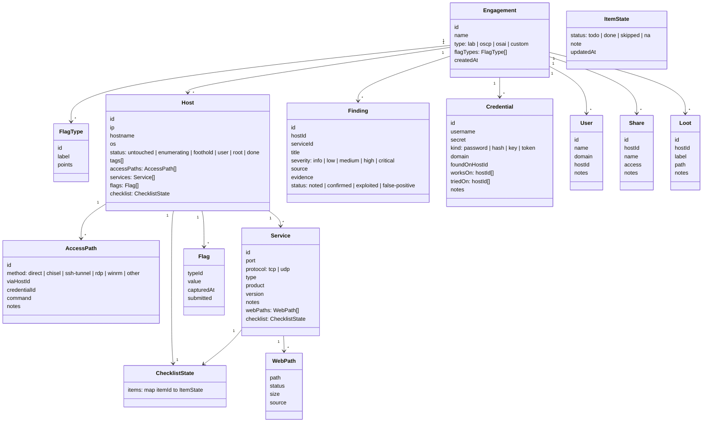
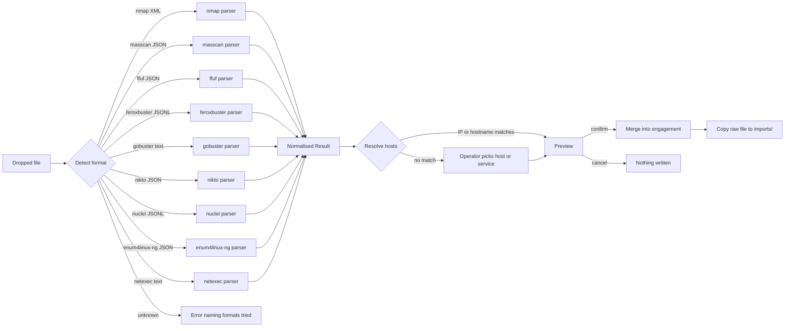
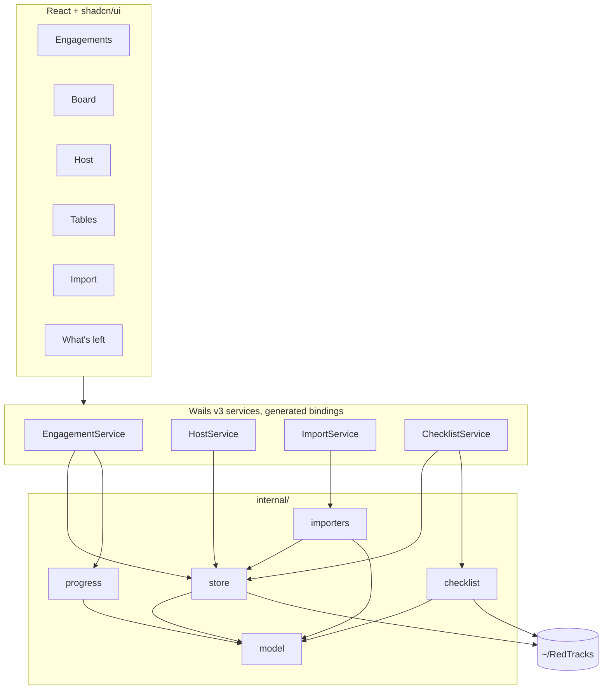

# RedTracks, slice one: structured target tracker

Date: 2026-10-12 Status: draft for review License of the resulting code: Apache-2.0

## 1. Purpose

RedTracks is a desktop app for tracking targets, enumeration state, credentials, and findings during OffSec labs and exams (OSCP+, OSAI). It exists because structure imposed by templates in a general note app does not help an operator remember what has been tried. Structure here is data, not prose.

It is built for one operator first. Publishing it and learning Wails are side benefits and do not bend the design.

Success for slice one: the operator works a Proving Grounds box or an AI-300 challenge lab end to end in RedTracks without opening Obsidian.

### Out of scope for slice one

Each of these gets its own spec later:

- Evidence capture (screenshots, command output with timestamps).
- Knowledge base across engagements (technique library, search).
- Report generation.
- Linux build. Nothing in this design precludes it; it is simply not built or tested in slice one.

## 2. Decisions

| Area           | Decision                                                  | Why                                                                                                                                        |
| -------------- | --------------------------------------------------------- | ------------------------------------------------------------------------------------------------------------------------------------------ |
| Shell          | Wails v3 beta, pinned to one tag                          | Go backend, native macOS WebKit window, server build mode as an emergency fallback, generated TypeScript bindings keep the frontend honest |
| Backend        | Go 1.27                                                   | Parsers, file formats, and all tested logic live here                                                                                      |
| Frontend       | React, TypeScript, Tailwind, shadcn/ui, mermaid.js        | Operator is comfortable with shadcn; frontend is tables and forms, not where the interesting code is                                       |
| Storage        | Plain JSON files, one folder per engagement               | Readable and editable without the app during an exam; JSON over YAML to avoid whitespace mistakes                                          |
| Checklists     | JSON files in a shared user directory, shipped sample set | The format is the product; the content is the operator's to curate                                                                         |
| Theme          | Dark only                                                 | Lives beside a Kali VM window                                                                                                              |
| Root directory | `~/RedTracks`, overridable by `REDTRACKS_HOME`            | One knob, nothing else                                                                                                                     |
| Network        | None. No telemetry, no update check, no outbound calls    | Exam proctoring and trust                                                                                                                  |
| Diagrams       | Autogenerated Mermaid, rendered in-app                    | Operator preference; the attack graph is the first instance                                                                                |

## 3. Domain model



Notes on the model:

- **Service type** is an open string. Traditional types come from nmap service names (`http`, `smb`, `ldap`, `kerberos`, `ssh`, `mssql`, and so on). AI types are set by the operator: `llm-chat`, `mcp-server`, `agent`, `rag-api`, `vector-store`, `model-registry`, `inference-api`. Importers never guess an AI type.
- **Hashes** are credentials with `kind: hash`. There is no separate hash table.
- **`triedOn`** on a credential is what makes "creds never tried against this host" computable.
- **Default flag types by engagement type.** `lab`: local (10), proof (10). `oscp`: local (10), proof (10). `osai`: ai_vector (15), trad_vector (10), proof (5). `custom`: empty. The operator edits them in `engagement.json`.
- **Record IDs** are generated with `crypto/rand.Text()` from the standard library. They are opaque and never shown as the primary label.

## 4. Files on disk

```
~/RedTracks/
  checklists/
    http.json
    smb.json
    ldap.json
    mcp-server.json
    llm-chat.json
    rag-api.json
    linux-privesc.json
    windows-privesc.json
  engagements/
    pg-nibbles/
      engagement.json
      notes.md
      creds.json          credentials, users, shares, loot
      findings.json
      hosts/
        10.10.10.5/
          host.json       host record, access paths, services, flags, checklist state
          notes.md
          imports/
            nmap-20261012-140312.xml
  redtracks.log
```

### 4.1 Ownership

**Human-owned.** The app reads and displays, and for `notes.md` edits in place, but never restructures. `notes.md` files and everything under `checklists/`.

**App-owned.** JSON written by the app with two-space indentation and field order fixed by Go struct order, so hand edits and diffs stay small. `engagement.json`, `creds.json`, `findings.json`, `host.json`.

**Imports.** Raw tool output is copied unchanged into `hosts/<ip>/imports/` with a tool prefix and timestamp. When one import touches several hosts (an nmap scan of a subnet), the raw file is stored under the first host and referenced by path from the others.

### 4.2 Faith-keeping rules

These rules exist because the operator will edit these files in vim while the app is open.

1. The app loads an engagement folder into memory on open. There is no cache and no index.
2. Every write is atomic: write to a temp file in the same directory, fsync, rename over the original. One function in the store package performs all writes. There is no second write path.
3. The store keeps a SHA-256 of the bytes it last read for every file. Before a write it re-reads the file. If the hash differs, the file was edited externally: the store reparses it, applies the pending mutation to the fresh document, and writes that. Mutations are closures keyed by record ID, so they apply cleanly to a document that changed underneath them.
4. A poller checks file modification times every two seconds and reloads any file that changed. Ten hosts is roughly fifteen files; polling is cheaper than a dependency. `ponytail: mtime poll, swap for fsnotify if an engagement ever has hundreds of hosts.`
5. A file that fails to parse is reported with path, line, and column. The app refuses to overwrite it and never rewrites a file to "fix" it.
6. Missing files are not errors on read. A host folder with only `notes.md` is a host with no structured state yet.

### 4.3 Example `host.json`

```json
{
  "id": "K3M7Q2ZX9A",
  "ip": "10.10.10.5",
  "hostname": "nibbles",
  "os": "linux",
  "status": "foothold",
  "tags": [
    "chain-a"
  ],
  "accessPaths": [
    {
      "id": "H8T2WQ4N1B",
      "method": "direct",
      "viaHostId": "",
      "credentialId": "",
      "command": "",
      "notes": "public IP, reachable from attacker box"
    }
  ],
  "services": [
    {
      "id": "P1R9X3LM6C",
      "port": 80,
      "protocol": "tcp",
      "type": "http",
      "product": "Apache httpd",
      "version": "2.4.18",
      "notes": "",
      "webPaths": [
        {
          "path": "/nibbleblog/",
          "status": 200,
          "size": 2986,
          "source": "gobuster"
        }
      ],
      "checklist": {
        "items": {
          "http.robots": {
            "status": "done",
            "note": "",
            "updatedAt": "2026-10-12T14:08:11Z"
          },
          "http.dirbust": {
            "status": "done",
            "note": "gobuster common.txt",
            "updatedAt": "2026-10-12T14:20:40Z"
          },
          "http.vhosts": {
            "status": "todo",
            "note": "",
            "updatedAt": ""
          }
        }
      }
    }
  ],
  "flags": [
    {
      "typeId": "local",
      "value": "f2a1...",
      "capturedAt": "2026-10-12T15:02:00Z",
      "submitted": true
    },
    {
      "typeId": "proof",
      "value": "",
      "capturedAt": "",
      "submitted": false
    }
  ],
  "checklist": {
    "items": {}
  }
}
```

## 5. Checklist definitions

One JSON file per definition under `checklists/`. The app reads them at startup and on every poll tick, so edits show up without a restart.

```json
{
  "id": "http",
  "title": "HTTP / HTTPS",
  "match": {
    "serviceTypes": [
      "http",
      "https",
      "http-proxy",
      "http-alt"
    ]
  },
  "items": [
    {
      "id": "http.robots",
      "title": "robots.txt, sitemap.xml, .well-known",
      "hint": "",
      "commands": [
        "curl -s http://$T/robots.txt"
      ]
    },
    {
      "id": "http.dirbust",
      "title": "Directory brute force",
      "hint": "Try at least two wordlists and common extensions",
      "commands": [
        "feroxbuster -u http://$T -x php,txt,html"
      ]
    },
    {
      "id": "http.vhosts",
      "title": "Virtual host enumeration",
      "hint": "",
      "commands": [
        "ffuf -u http://$T -H 'Host: FUZZ.$D' -w subdomains.txt -fs 0"
      ]
    }
  ]
}
```

Rules:

- `match.serviceTypes` matches a service by type. `match.hostOS` matches a host (used by privesc lists). A definition may use either or both.
- Item IDs are stable strings chosen by the author. State is keyed by item ID. Renaming an item's title keeps its history; changing its ID starts fresh. The app does not try to be clever about this.
- `$T` and `$D` in commands are placeholders for the target IP and domain. The app substitutes them when copying a command to the clipboard. There is no other templating.
- The shipped sample covers `http`, `smb`, `ldap`, `kerberos`, `ssh`, `mcp-server`, `llm-chat`, `rag-api`, `linux-privesc`, and `windows-privesc`, each with five to ten items. The sample is a starting point and says so in a `_readme.md` in the directory.
- On first launch the app copies the sample set into `~/RedTracks/checklists/` only if that directory does not exist. It never overwrites an existing checklist.

## 6. Importers



### 6.1 Tools in slice one, in priority order

| Group     | Tool          | Input               | Produces                                                      |
| --------- | ------------- | ------------------- | ------------------------------------------------------------- |
| Port scan | nmap          | XML                 | hosts, hostnames, OS guess, services with product and version |
| Port scan | rustscan      | XML (it wraps nmap) | same as nmap, no separate parser                              |
| Port scan | masscan       | JSON                | hosts, open ports with empty type                             |
| Vuln scan | nikto         | JSON                | findings on an http service                                   |
| Vuln scan | nuclei        | JSONL               | findings on a service, severity from template                 |
| Web enum  | ffuf          | JSON                | web paths on a service                                        |
| Web enum  | feroxbuster   | JSONL               | web paths on a service                                        |
| Web enum  | gobuster      | text (dir mode)     | web paths on a service                                        |
| SMB / AD  | enum4linux-ng | JSON                | users, shares, domain, OS                                     |
| SMB / AD  | netexec       | text                | users, shares, OS, signing, credential validity               |

### 6.2 Contract

Every parser is a function `func Parse(r io.Reader) (Result, error)` in its own file under `internal/importers/`. `Result` is one struct for all tools:

```go
type Result struct {
    Tool  string
    Hosts []HostResult
}

type HostResult struct {
    IP       string // may be empty when the tool only knows a URL
    Hostname string
    OS       string
    URL      string // for web tools, used to resolve host and service
    Services []ServiceResult
    WebPaths []WebPathResult
    Findings []FindingResult
    Users    []UserResult
    Shares   []ShareResult
}
```

Detection sniffs the first few kilobytes: `<nmaprun` for nmap, a JSON array whose objects carry `ports` for masscan, `"commandline"` plus `"results"` for ffuf, lines with `"type":"response"` for feroxbuster, lines matching `^/\S+\s+\(Status: \d+\)` for gobuster, `"vulnerabilities"` with `"host"` for nikto, `"template-id"` for nuclei, top-level `"target"` and `"users"` or `"shares"` for enum4linux-ng, and lines starting with `SMB` or `LDAP` followed by an IP and port for netexec. Adding a tool means adding one parser file, one sniff rule, and one fixture.

### 6.3 Merge rules

- A host is matched by IP. If none exists it is created with status `untouched`.
- A service is matched by port and protocol. An existing service keeps its type, product, version, and notes unless those fields are empty, in which case the import fills them. An import never overwrites an operator-set type.
- Web paths are deduplicated by path and status.
- Findings are deduplicated by source and title per service.
- Users and shares are deduplicated by name per host.
- The preview shows every row with a badge: `new`, `fills`, or `duplicate`. Nothing is written until the operator confirms.

## 7. Progress, the "what's left" computation

Pure functions in `internal/progress` over the loaded engagement. No I/O.

Per host:

- **Missing flags.** Flag types in the engagement with no value on this host.
- **Untouched services.** Services with a matching checklist where every item is `todo`.
- **Open items.** Count of `todo` items across host and service checklists.
- **Untried credentials.** Credentials in the engagement whose `triedOn` and `worksOn` do not include this host, excluding credentials found on this host.
- **No access path.** True when the host has no access path and status is beyond `untouched`.

Board sort: ascending by captured flag points over total points, then by checklist completion ratio. The neglected host is on top.

## 8. Attack graph

A pure function in `internal/progress` emits Mermaid text from the engagement:

- `flowchart LR`.
- One node `attacker` labelled with the attacker box.
- One node per host labelled `ip` and hostname, with a class per status so the frontend colours by state.
- One edge per access path: from `viaHostId` when set, otherwise from `attacker`, to the host, labelled with the method.
- Hosts with no access path appear unconnected, which is itself the signal.

The frontend renders it with mermaid.js on the Board. It re-renders whenever the engagement changes. A second graph, credential reuse (credential nodes to the hosts they work on), is cheap once this exists and is in scope for slice one if time allows; it is not required for done.

## 9. Architecture



### 9.1 Go packages

| Package              | Responsibility                                                                           | Depends on       |
| -------------------- | ---------------------------------------------------------------------------------------- | ---------------- |
| `internal/model`     | Types only                                                                               | nothing          |
| `internal/store`     | Load engagement, atomic write, hash-check and reapply, mtime poll, parse error reporting | model            |
| `internal/checklist` | Load definitions, match to service or host, merge definition with state                  | model            |
| `internal/importers` | One parser per tool, detection, normalised result                                        | model            |
| `internal/progress`  | What's left, board sort, Mermaid attack graph                                            | model, checklist |
| `cmd/redtracks`      | Wails application, service structs, window                                               | all of the above |

Wails services are thin. They translate frontend calls into store mutations and return model types. No business logic lives in them.

### 9.2 Frontend screens

1. **Engagements.** List under `~/RedTracks/engagements`, open one, create one with a type picker that sets flag types.
2. **Board.** One row per host: IP and hostname, status, flag chips, checklist progress, access path summary. Attack graph above the table. Sorted per section 7.
3. **Host.** Header with status, flags, and access paths. Services list on the left. Selected service on the right with its checklist, web paths, and findings. Host-level checklists (privesc) in their own tab. Notes editor at the bottom: a textarea with a rendered-preview toggle; preview renders Markdown and Mermaid blocks.
4. **Tables.** Credentials, users, shares, loot, findings. Credential rows show `works on` and `tried on` chips and a one-click "tried on host X" action.
5. **Import.** Drop zone or file picker. Detection result, parsed rows with `new`, `fills`, `duplicate` badges, host resolution with a picker when unresolved, confirm button.
6. **What's left.** Grouped by host, the five signals from section 7, each item a link into the Host screen.

Keyboard: `cmd+k` opens a command palette to jump to a host or service by IP, hostname, or port. Checklist items toggle with space. That is the whole keyboard story for slice one.

## 10. Errors and logging

- Parse failures surface in the UI with path, line, and column, and the file is left untouched.
- Unknown import formats say so and list the formats tried.
- Write failures surface in the UI as a persistent toast and are written to `~/RedTracks/redtracks.log` with the path and the Go error.
- The log is plain text, appended, rotated at 5 MB by renaming to `.1`. No log framework beyond `log/slog`.
- Nothing is swallowed. A function that can fail returns an error, and every error reaches either the UI or the log, usually both.

## 11. Testing

Logic lives in Go, so that is where the tests are.

| Package     | Tests                                                                                                                                                                                                                                                      |
| ----------- | ---------------------------------------------------------------------------------------------------------------------------------------------------------------------------------------------------------------------------------------------------------- |
| `store`     | Load a fixture engagement, mutate, write, reload, compare. Concurrent external edit then app write: both changes present. Corrupt JSON: error carries line and column, file bytes unchanged. Atomic write: a failure mid-write leaves the original intact. |
| `importers` | One real fixture per tool, captured from the tool itself, with a table test asserting the normalised result. Detection test over all fixtures plus a garbage file.                                                                                         |
| `checklist` | Match by service type, by host OS, by both. State merge when a definition gained, lost, or renamed an item.                                                                                                                                                |
| `progress`  | Missing flags, untouched services, untried creds, board ordering, Mermaid output against a golden file.                                                                                                                                                    |

Frontend: vitest smoke tests for the Import preview and the checklist component. One Playwright happy path against the Wails server build: create an engagement, import the nmap fixture, open the host, tick an item, confirm `host.json` on disk reflects it. No pixel tests.

Target is 80% line coverage in `internal/`. Coverage is not measured for `cmd/` or the frontend.

## 12. Build and tooling

- Go 1.27, Wails v3 pinned to a single beta tag in `go.mod` and `Taskfile.yml`. Bumping the pin is a deliberate commit on its own.
- `wails3 init -t react-ts` is the scaffold. Tailwind and shadcn/ui added on top with the shadcn CLI. mermaid.js as a frontend dependency.
- Taskfile targets: `dev`, `build`, `test` (Go and vitest), `e2e` (Playwright against server build), `lint` (`go vet`, `staticcheck`, eslint).
- Repository layout:

```
redtracks/
  cmd/redtracks/
  internal/{model,store,checklist,importers,progress}
  checklists/            shipped sample set, embedded with go:embed
  frontend/
  docs/superpowers/specs/
  Taskfile.yml
  LICENSE                Apache-2.0
```

## 13. Definition of done for slice one

- All six screens work on macOS against a real engagement folder.
- All ten importers parse their fixtures and merge per section 6.3.
- The faith-keeping rules in section 4.2 hold under the store tests.
- The shipped checklist set covers the ten definitions in section 5.
- The attack graph renders on the Board.
- The operator has worked one Proving Grounds box and one AI-300 challenge lab in RedTracks and did not open Obsidian.
